## Announcements

- Practice Examlet 4 is available.
- Lab 8 (memoization) and POTW 8 (mostly Sudoku validity) due Sunday.
- Project 2 (Game of Life) released, due Monday November 16.
  - Time to get started!
- **Next week:** No labs, no POTWs, no examlet.
  - Normal lecture on Thursday November 12.

- Feeling overwhelmed?  You are not alone!
  - Visit [student health services'](https://students.ubc.ca/health/) [mental health resources](https://students.ubc.ca/health/mental-health-care-ubc/).


# State Space Graphs

## Reminder: [Rush Hour Game](https://puzzle.now/rushhour/) {.medium}

::::: columns
::: {.column}
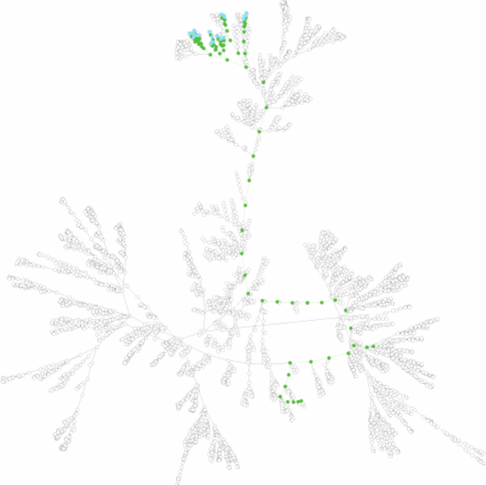{alt="Rush hour game state graph"}
:::
::: {.column}
<center>
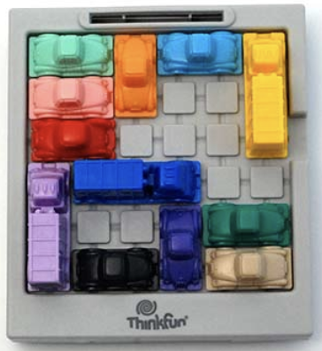
</center>

- $V$: State of the board / position of all cars / configuration.
- $E$: Connect two configurations if there is a legal move between them.
- Path is a sequence of legal moves, hopefully leading to a winning configuration.
:::
::::: 

::: notes
- We looked at this game last week as an example of a graph.
- This lecture we will explore how to build a game solver using graphs.
:::

## Game Graphs: [Tic-Tac-Toe](https://en.wikipedia.org/wiki/Tic-tac-toe)

Two players take turns marking a cell in a 3 x 3 grid.

- Traditionally, the marks are `X` and `O`, and `X` goes first.

::: {.columns}

::: {.column width=70%}
How might we represent a state?

- How many possible states are there?
- What about symmetry?
- Given a state, what moves are available?
:::

::: {.column width=30%}
<center>
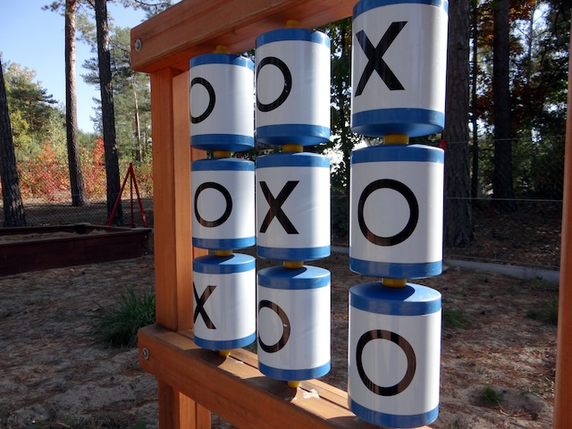{alt="tic-tac-toe game in a playground"} \
[photo by Przemysław Czopor]{style="font-size: 20px;"}
</center>
:::

:::

::: notes
- Also called "knots and crosses" (English) or "exs and ohs" (Canada).
- Representation could be 3x3 array, list of 9 elements
  - Consider list of alternating moves labeled by an integer.
- Using simple boards, draw a sequence of moves with (directed) edges between them.
  - 3 possible values for each of 9 squares: $3^9 = 19,683$
  - But: There always has to be same number of X and O, or one more X.
  - Also: Rotational and mirror symmetries.
- Only 765 valid states after alternating play and symmetry.
  - 626 are mid game.
  - Remainder are terminal: 91 games X has won, 44 games O has won and 3 games are a draw.
:::

## TicTacToe State Space Graph
<center>
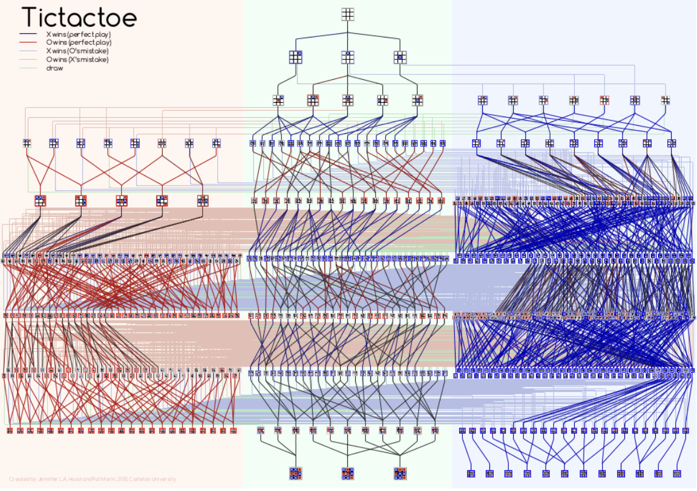

[XKCD's map of optimal moves](https://xkcd.com/832/)
</center>

::: notes
- Shows the entire state graph of the game (ignoring symmetries).
  - But the number of terminal states doesn't line up with other sources...
- Early 1950s: One of the earliest video games (computer could play a perfect game).
- Late 1970s: MIT students built the tinker-toy mechanical computer.
- Let's look at a more difficult game.
:::


# Sudoku

## [Sudoku](https://en.wikipedia.org/wiki/Sudoku)

- Fill in the grid with the numbers 1 to 9.
  - No number may appear twice in a row, column, or 3x3 subgrid.

::: {style="font-size: 28px;"}
::: {.columns}
::: {.column}
<center>
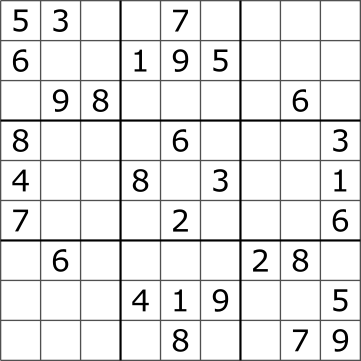{width=50%}

example starting board

::: {style="font-size: 16px;"}
[By Tim Stellmach - <a href="http://creativecommons.org/publicdomain/zero/1.0/deed.en" title="Creative Commons Zero, Public Domain Dedication">CC0</a>, <a href="https://commons.wikimedia.org/w/index.php?curid=57831926">Link</a>]
:::
</center>
:::

::: {.column}
<center>
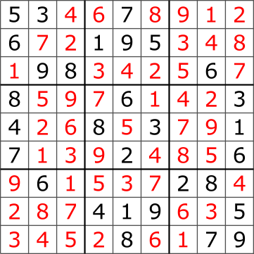{width=50%}

solution to example

::: {style="font-size: 16px;"}
[By <a href="https://en.wikipedia.org/wiki/User:Cburnett" class="extiw" title="en:User:Cburnett">en:User:Cburnett</a> - <a href="https://creativecommons.org/licenses/by-sa/3.0" title="Creative Commons Attribution-Share Alike 3.0">CC BY-SA 3.0</a>, <a href="https://commons.wikimedia.org/w/index.php?curid=57831971">Link</a>]
:::
</center>
:::

:::

:::

## Representing Sudoku

For an evolving system (typically *Markovian*):

- A *state* is the current status or configuration of the system.
- The *state space* is the set of all possible states.

How might you represent this Sudoku state?

<center>
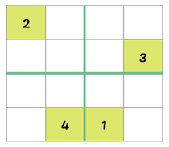
</center>

::: notes
- Remember: A system is *Markovian* if we need only its current state (nothing else about its history) to predict its future.
  - Is tic-tac-toe Markovian?  Is sudoku?
- Could use 
  - 2D array.
  - List of lists.
  - List of locations and values (very efficient if most locations are empty, much less so as the board fills up).
- Each entry could be integer, unsigned, interval, enumeration, string.
  - How do we represent an unfilled cell?
:::

## State Space Graphs

- A vertex is a (valid) state.
- Edges connect states if there is a valid move between them.

How many neighbors does this vertex have?

<center>


</center>

::: notes
- Does sudoku have any *invalid* moves?
  - An invalid move results in an invalid state.
- In each board, enumerate the possible values in a different empty cell.
  - Do not enumerate in the (1,2) cell (we do that in the next slide).
:::


## Exploring the Sudoku Graph {.medium}

- Given a vertex, we need to choose a neighbour vertex to consider.
  - Choose an empty cell, build set of possible consistent values, choose one.
  - Choose an empty cell, choose a value, see if next state is valid.

<center>
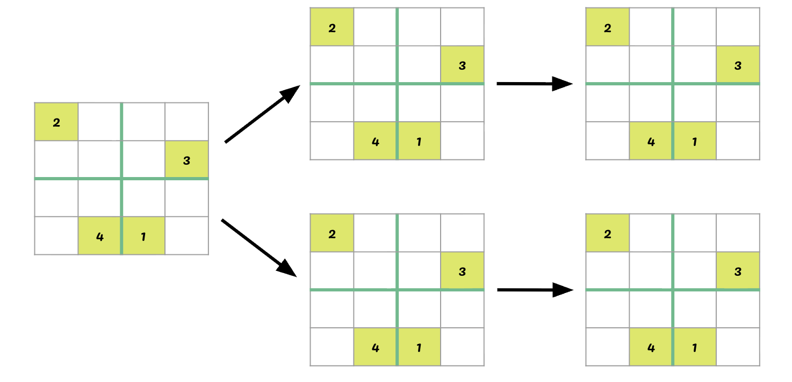{width=75%}
</center>

::: notes
- "Choose" could mean a deterministic or random choice.
- We win if the valid state is full.
- We have to retreat if there are no valid neighbours.
- We will use the latter approach because it is easier to code: No need to reason about constraints, just pick a value and see if it is valid.
:::

# Graph Search

## Reminder: Flood Fill Pattern

::::: columns
::: {.column}
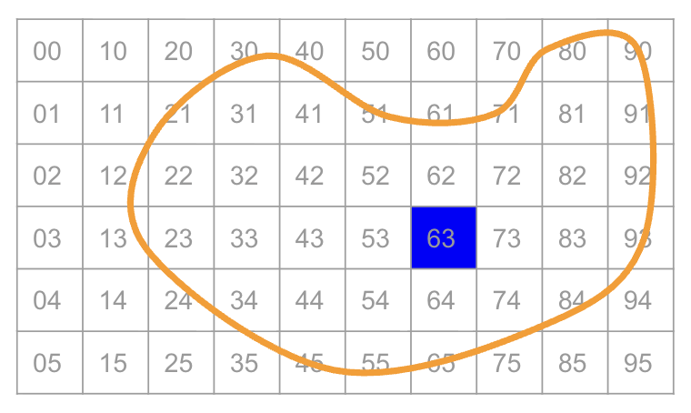{fig-alt="Grid with each pixel numbered, pixel 63 highlighted blue, subset of pixels surrounded by a yellow curve."}
:::

::: {.column}
- enqueue a starting point
- while the queue is not empty:
   - v = dequeue
   - for each valid neighbor w of v:
      - process w
      - enqueue w
:::
::::::

<svg xmlns="http://www.w3.org/2000/svg" width="1090" height="70" viewBox="0 0 1090 70">
  <rect x="5"    y="5" width="60" height="60" fill="none" stroke="#222" stroke-width="1.5"/>
  <rect x="65"   y="5" width="60" height="60" fill="none" stroke="#222" stroke-width="1.5"/>
  <rect x="125"  y="5" width="60" height="60" fill="none" stroke="#222" stroke-width="1.5"/>
  <rect x="185"  y="5" width="60" height="60" fill="none" stroke="#222" stroke-width="1.5"/>
  <rect x="245"  y="5" width="60" height="60" fill="none" stroke="#222" stroke-width="1.5"/>
  <rect x="305"  y="5" width="60" height="60" fill="none" stroke="#222" stroke-width="1.5"/>
  <rect x="365"  y="5" width="60" height="60" fill="none" stroke="#222" stroke-width="1.5"/>
  <rect x="425"  y="5" width="60" height="60" fill="none" stroke="#222" stroke-width="1.5"/>
  <rect x="485"  y="5" width="60" height="60" fill="none" stroke="#222" stroke-width="1.5"/>
  <rect x="545"  y="5" width="60" height="60" fill="none" stroke="#222" stroke-width="1.5"/>
  <rect x="605"  y="5" width="60" height="60" fill="none" stroke="#222" stroke-width="1.5"/>
  <rect x="665"  y="5" width="60" height="60" fill="none" stroke="#222" stroke-width="1.5"/>
  <rect x="725"  y="5" width="60" height="60" fill="none" stroke="#222" stroke-width="1.5"/>
  <rect x="785"  y="5" width="60" height="60" fill="none" stroke="#222" stroke-width="1.5"/>
  <rect x="845"  y="5" width="60" height="60" fill="none" stroke="#222" stroke-width="1.5"/>
  <rect x="905"  y="5" width="60" height="60" fill="none" stroke="#222" stroke-width="1.5"/>
  <rect x="965"  y="5" width="60" height="60" fill="none" stroke="#222" stroke-width="1.5"/>
  <rect x="1025" y="5" width="60" height="60" fill="none" stroke="#222" stroke-width="1.5"/>
</svg>

::: notes
- Using a FIFO queue, we visited the pixels (nodes) in order of their distance (number of edges) from the initial pixel (node).
:::

## [Breadth First Search](https://en.wikipedia.org/wiki/Breadth-first_search) (BFS)

::: {.columns}
::: {.column width=60%}
- Explores a graph starting from a *root* node.
- Explores all nodes at a specified *depth* (distance from the root) before exploring any at the next depth.

Other animations of BFS

- [see-algorithms.com](https://see-algorithms.com/graph/BFS)
- [algomaster.io](https://algomaster.io/animations/dsa-concepts/graph-bfs)
:::

::: {.column width=40%}
<center>
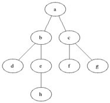{width=80%}

::: {style="font-size: 16px;"}
[By <a href="https://commons.wikimedia.org/wiki/File:Animated_BFS.gif">Blake Matheny</a>, <a href="http://creativecommons.org/licenses/by-sa/3.0/">CC BY-SA 3.0</a>]
:::
</center>
:::

:::

::: notes
- BFS worked great for flood fill / Voronoi regions.
- In Sudoku, it would fill in all possible values for a given empty cell before considering any other empty boxes.
- Why is it a bad idea for solving sudoku (or other games / mazes)?
  - You want to get to a terminal state.
  - Terminal state is a (relatively) long distance from the root.
  - There are a **lot** of intermediate states that BFS would have to consider before it could get to a terminal state.
:::

## [Depth First Search](https://en.wikipedia.org/wiki/Depth-first_search) (DFS)

::: {.columns}
::: {.column width=60%}
- Explores a graph starting from a *root* node.
- Fully explores each subgraph before moving on to the next node at the current depth.

Other animations of DFS

- [see-algorithms.com](https://see-algorithms.com/graph/DFS)
- [algomaster.io](https://algomaster.io/animations/dsa-concepts/graph-dfs)
:::

::: {.column width=40%}
<center>
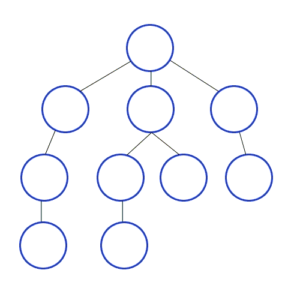{width=80%}

::: {style="font-size: 16px;"}
[By <a href="https://commons.wikimedia.org/wiki/File:Depth-First-Search.gif">Mre</a>, <a href="https://creativecommons.org/licenses/by-sa/3.0">CC BY-SA 3.0</a>]
:::
</center>
:::
:::

::: notes
- For Sudoku, DFS keeps filling in new empty boxes until it hits an invalid state.
:::

## Implementing DFS

::::: {.columns}
::: {.column width=50%}
- Can be implemented via recursion.
- We will use a stack / LIFO queue.

<center>
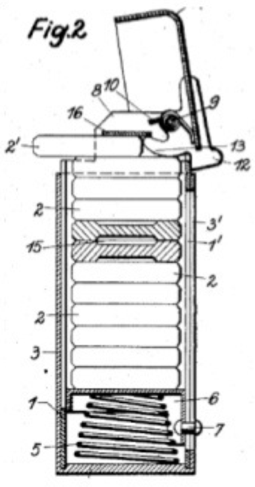
</center>
:::
::: {.column width=50%}
Pseudo-code stack functions:

* Insert: push(item)
* Remove: pop() $\rightarrow$ item

Python `deque` (or `list`) functions:

* Insert: `append(item)`
* Remove: `pop()` $\rightarrow$ `item`

:::
:::::


## Depth First Search Practice

::::: columns
::: {.column width=60%}

- `push(start_vertex)` 
- while the `stack` is not empty:
   - v = `pop()`
   - if `v` is not processed:
      - process `v`
      - for each valid neighbor `w` of `v`:
         - `push(w)`

:::
::: {.column width=30%}
<svg xmlns="http://www.w3.org/2000/svg"
     viewBox="0 0 220 400"
     width="330" height="600" role="img"
     aria-label="Graph with vertices A,B,C,D,E">
  <style>
    .node { fill:#d9f3f7; stroke:#000; stroke-width:4; }
    .edge { stroke:#000; stroke-width:4; fill:none; }
    .label { font: 18px ui-sans-serif, system-ui, -apple-system, "Segoe UI", Arial;
             text-anchor:middle; dominant-baseline:middle; }
  </style>
  <line x1="110" y1="80"  x2="170" y2="200" class="edge"/>
  <line x1="110" y1="80"  x2="50"  y2="200" class="edge"/>
  <line x1="170" y1="200" x2="50"  y2="200" class="edge"/>
  <line x1="170" y1="200" x2="110" y2="260" class="edge"/>
  <line x1="50"  y1="200" x2="110" y2="260" class="edge"/>
  <line x1="170" y1="200" x2="110" y2="340" class="edge"/>
  <line x1="110" y1="260" x2="110" y2="340" class="edge"/>
  <line x1="50"  y1="200" x2="110" y2="340" class="edge"/>
  <circle cx="170" cy="200" r="22" class="node"/>
  <circle cx="110" cy="80"  r="22" class="node"/>
  <circle cx="50"  cy="200" r="22" class="node"/>
  <circle cx="110" cy="260" r="22" class="node"/>
  <circle cx="110" cy="340" r="22" class="node"/>
  <text x="170" y="200" class="label">A</text>
  <text x="110" y="80"  class="label">B</text>
  <text x="50"  y="200" class="label">C</text>
  <text x="110" y="260" class="label">D</text>
  <text x="110" y="340" class="label">E</text>
</svg>
:::

::: {.column width=10%}
\

<center>
<svg xmlns="http://www.w3.org/2000/svg" width="70" height="430" viewBox="0 0 70 430">
  <rect x="5" y="5"    width="60" height="60" fill="none" stroke="#222" stroke-width="1.5"/>
  <rect x="5" y="65"   width="60" height="60" fill="none" stroke="#222" stroke-width="1.5"/>
  <rect x="5" y="125"  width="60" height="60" fill="none" stroke="#222" stroke-width="1.5"/>
  <rect x="5" y="185"  width="60" height="60" fill="none" stroke="#222" stroke-width="1.5"/>
  <rect x="5" y="245"  width="60" height="60" fill="none" stroke="#222" stroke-width="1.5"/>
  <rect x="5" y="305"  width="60" height="60" fill="none" stroke="#222" stroke-width="1.5"/>
  <rect x="5" y="365"  width="60" height="60" fill="none" stroke="#222" stroke-width="1.5"/>
</svg>
</center>
:::
:::::

::: notes
- Remember to start writing nodes from the bottom of the stack.
:::

# Back to Sudoku

## Sudoku Solver Algorithm {.medium}

- Search (DFS) through the states until you can’t go any farther.
  - If the board is complete, you win!
  - If the board is invalid, back up and try a new state in the most recent cell possible. 

<center>
{width=75%}
</center>

## State Validity {.medium}

Need to be able to check whether a state is *valid*.

::::: {.columns}
::: {.column}
Suppose we have a variable `grid`, representing the board, and we want to place a value called `num`, in position (x,y). 

Need to check uniqueness in:

* row
* column 
* block
:::
::: {.column}

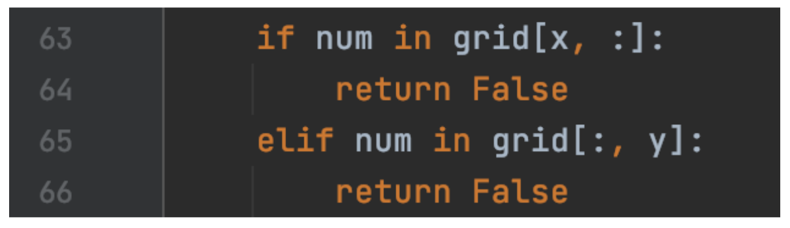

- Which conditional checks a row?
- Which conditional checks a column?
- How shall we check a block?
:::
:::::

## Block Validity {.medium}

**Python tidbit**: to query a region in a 2d matrix, define the bounds on the region and use `in`. 

In the small example below, `2 in grid[0:2,0:2]` returns `True`.

<center>

</center>

## Defining Blocks {.medium}

Given location $(x,y)$, determine the block in which it lives. 

::::: {.columns}
::: {.column width=75%}
- a region `s:t` contains $x$ if $s\leq x< t$.
- Look for a pattern in the tables below for a $4 \times 4$ grid.
- Can we generalize to an $r^2 \times r^2$ grid?
  - Hint: `x//r` is the integer part of `x/r`.
:::
::: {.column width=25%}
<center>

</center>
:::
:::::

<center>
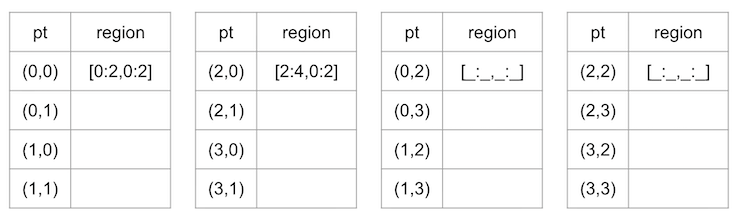
</center>

::: notes
- Generalization is `[(x // r) * r : (x // r + 1) * r]`
:::

## Which Cell Next?

We could choose next cell:

- Randomly.  We would then either:
  - Have to keep explicit track of which cells were still empty.
  - Repeatedly choose full cells and have to choose again.
- Deterministically.  We could either:
  - Build a double loop over 2D position $(x,y)$.
  - Build a single loop over 1D position and convert that to an $(x,y)$.

::: notes
We will do the latter, mostly as an example of how to turn a multidimensional index into a one dimensional index (linearizing) and vice-versa.
:::

## Linearizing the Cell Index

Write a function `postup` that takes an integer position `p` as input, and returns an `(x,y)` position. The grid is `size` $\times$ `size`.

::::: {.columns}
::: {.column width=25%}

:::
::: {.column width=75%}

``` {pyodide}
states = 10
def postup(p: int) -> tuple[int, int]:
    return (0,0)

print(postup(23))
```
:::
:::::

::: notes
`x = p % size` and `y = p // size`.
:::

## Demo {.activity}

Today's activity is already coded for you, but let's look through the code.

Launch [Class Activity: Sudoku](https://us.prairielearn.com/pl/course_instance/228149/assessment/2722856/) in PrairieLearn.

## Sudoku Closing Thoughts

::: {.columns}
::: {.column}
How fast does the state space grow as board size grows?

| size | cells | state space |
|:----:|:-----:|-------------|
| 2 | 4 x 4 |  |
| 3 | 9 x 9 |  |
| 4 | 16 x 16 |  |
| 5 | 25 x 25 |  |
| $r$ | $r^2$ x $r^2$ |  |

[Mathematics of Sudoku](https://en.wikipedia.org/wiki/Mathematics_of_sudoku)
:::

::: {.column}
Could we be smarter about what values to consider?

<center>
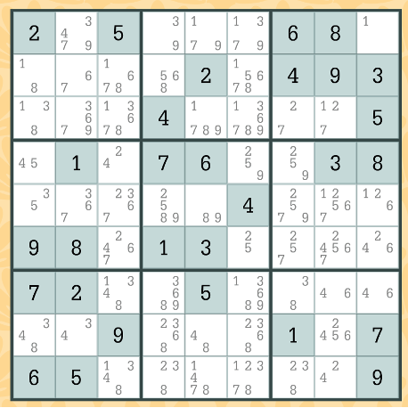
</center>
:::
:::

::: notes
- There are $r^4$ cells, each of which can have a value from 1 to $r^2$.  So it grows as $(r^2)^{(r^4)}$!
- For classic (size 3) sudoku, there are roughly $6.671×10^{21}$ states.
  - There are ways to reduce that by validity preserving transformations to just(!) 5,472,730,538.
  - Symmetry is an example of a validity preserving transformation, but it is not very useful in sudoku.
- That is exponential growth (the worst we considered).  In fact, Sudoku is known to be NP-complete.
:::