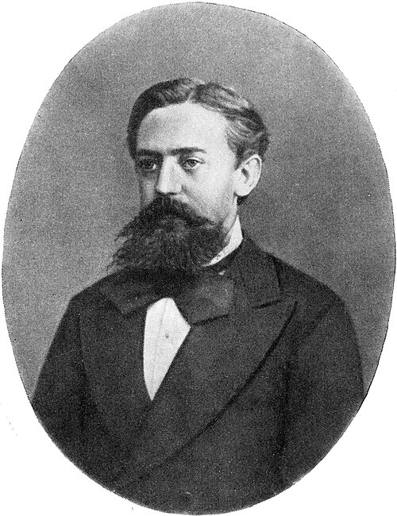
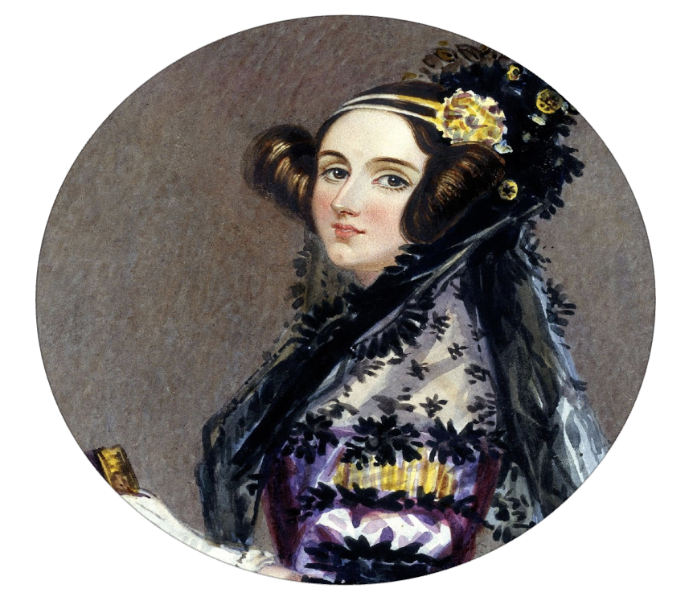
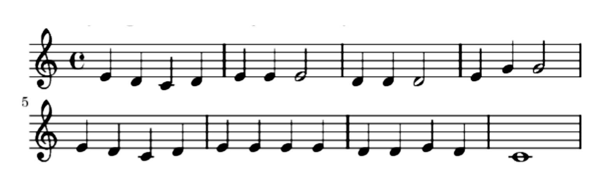
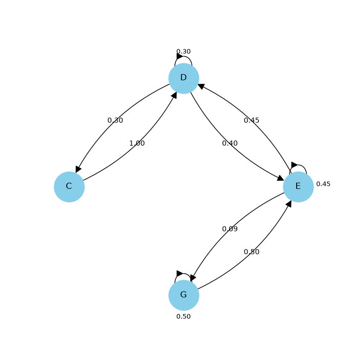
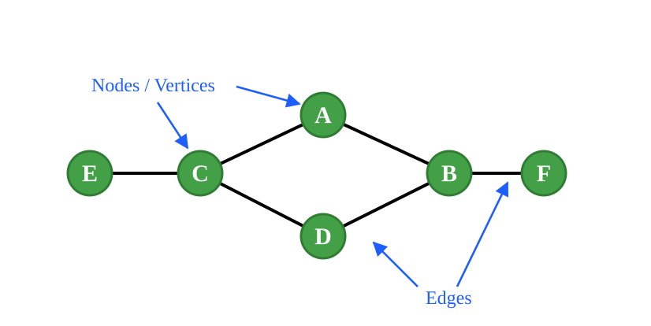
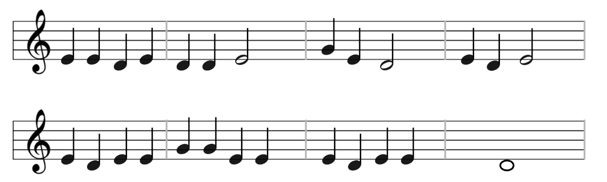

## Announcements

- Practice Examlet 4 is available.
- Lab 8 (memoization) and POTW 8 (mostly Sudoku validity) due Sunday.
- Project 2 (Game of Life) released, due Monday November 16.
  - Time to get started!

- Feeling overwhelmed?  You are not alone!
  - Visit [student health services'](https://students.ubc.ca/health/) [mental health resources](https://students.ubc.ca/health/mental-health-care-ubc/).

## Today's Destination: Markov Chains (MCs)

::: {.columns}

::: {.column width=75%}
- Last class we discussed *graphs* as a new data type.
  - Entities were represented by *nodes*.
  - The relationship between the entities was represented by *edges* between nodes.
- [*Markov chains*](https://en.wikipedia.org/wiki/Markov_chain) (or *Markov processes*) are a model for systems which evolve probabilistically.
- MCs can be represented as a graph
  - The nodes are the current state of the system.
  - The edges capture the probabilistic evolution to the next state.
:::

::: {.column width=25%}

[Andrey Markov](https://en.wikipedia.org/wiki/Andrey_Markov)

:::

:::

::: notes
- MCs are a *big* deal in the modeling world, and there are entire courses devoted to studying them.
- Particularly relevant in AI, NLP and LLMs.
- We are going to end up with an MC model, a representation of that MC which doesn't look like a graph, and finally a graph representation.
- Then we will look at code to construct the latter two.
:::

# Computer Generated Music

## Following Ada {.medium}

::::: columns
::: {.column width=50%}

[Ada Lovelace](https://en.wikipedia.org/wiki/Ada_Lovelace)

:::
::: {.column width=50%}
Supposing, for instance, that the **fundamental relations of** pitched **sounds** in the science of harmony and of musical composition were **susceptible of** such expression and **adaptations**, 

*the engine might compose elaborate and scientific pieces of music of any degree of complexity or extent.*

(Ada Lovelace -- 1842)
:::
:::::

::: notes
- AI generated music (and other creative products) is hot in the news today, but the idea has a surprisingly long history.
- Widely credited as being the first computer programmer.
- Worked with Charles Babbage, who proposed the first general purpose (albeit mechanical) computer, the "analytical engine".
- Lady Lovelace recognized that it could be used for purposes other than just calculating standard mathematical formulas.
  - That its numbers could encode other information!
:::

## Prelude

::: notes
- It is *not* music -- there is no sound.
- It is a human readable representation of music.
  - A trained person (or computer) could convert it into sound.
  - Excellent example of a legacy representation which has all sorts of weird quirks.
- How might we create a new piece of music using this piece as a guide?
:::

## Note Probabilities

::: {.columns}

::: {.column width=70%}

:::

::: {.column width=30%}
| Note | Count | Prob |
|:----:|:-----:|:----:|
| C | 3 | 0.12 |
| D | 10 | 0.38 |
| E | 11 | 0.42 |
| G | 2 | 0.08 |
| total | 26 | 1.00 |
:::

:::

::: notes
- We'll keep the same rhythm (note lengths) and just replace the pitch of the notes.
- We could choose notes randomly according to how often they appear in the piece.
  - How do we get from counts to probabilities?
- But there are patterns that would not capture.
  - C always appears at the end of a E-D-C downward sequence.
  - E is almost always followed by another E.
  - D is often followed by another D but not as often as the E pattern.
:::

## Note Transition Probabilities

::: {}

{width="60%"}

:::

::: {.columns}

::: {.column width=50%}

|   | C | D | E | G |
|---|---|---|---|---|
| **C** | 0 | 2 | 0 | 0 |
| **D** | 3 | 3 | 4 | 0 |
| **E** | 0 | 5 | 5 | 1 |
| **G** | 0 | 0 | 1 | 1 |

:::

::: {.column width=50%}

|   | C | D | E | G |
|---|---|---|---|---|
| **C** | 0.00 | 1.00 | 0.00 | 0.00 |
| **D** | 0.30 | 0.30 | 0.40 | 0.00 |
| **E** | 0.00 | 0.45 | 0.45 | 0.10 |
| **G** | 0.00 | 0.00 | 0.50 | 0.50 |

:::

:::

::: notes
- Still keeping the same rhythm.
- From row to column.
- How do we get from counts to probabilities?
  - Note that each row sums to 1.0.
- Now we capture short (two note) patterns:
  - C is always followed by D.
  - E is usually followed by D or E, but occasionally G.
  - D might be anything *other than* G.
:::

# Markov Chains

## Visualizing the Markov Chain {.medium}

::: {.columns}

::: {.column width=60%}
- Transition table / matrix is a representation of an MC model.
- Alternative representation using directed graph:
  - Each node is a state of the model.
  - Each directed edge is labelled with the probability of the corresponding transition.

|   | C | D | E | G |
|---|---|---|---|---|
| **C** | 0.00 | 1.00 | 0.00 | 0.00 |
| **D** | 0.30 | 0.30 | 0.40 | 0.00 |
| **E** | 0.00 | 0.45 | 0.45 | 0.10 |
| **G** | 0.00 | 0.00 | 0.50 | 0.50 |

:::

::: {.column width=40%}

[MC visualization tool](http://setosa.io/markov#{"tm"%3A[[0.0%2C1.0%2C0.0%2C0.0]%2C[0.3%2C0.3%2C0.4%2C0.0]%2C[0.0%2C0.45%2C0.45%2C0.1]%2C[0.0%2C0.0%2C0.5%2C0.5]]})

[MC visual explainer](https://setosa.io/blog/2014/07/26/markov-chains/index.html)

:::

:::

## Markov Chains

- Broadly used model of evolving systems.
  - Google's original search algorithm PageRank.
  - Natural language processing (NLP).
  - DNA matching.
  - Chemical reaction simulation.
  - Many, many more...
- Closely related to [finite state machines](https://en.wikipedia.org/wiki/Finite-state_machine) and [Markov decision processes](https://en.wikipedia.org/wiki/Markov_decision_process).
  - All these models exhibit the [Markov property](https://en.wikipedia.org/wiki/Markov_property): Future evolution depends only on current state (and *not* on previous history).

::: notes
- PageRank: Some pages are more likely to "follow" (be linked from) other pages.
  - Start at a random page on the web.  Randomly click a link on the page, and repeat forever.
  - PageRank captures the probability that you'll be on a given page at any given moment.
  - You are more likely to be at a page if it has more incoming links, especially from other popular pages.
- NLP: Consider the probability of the next word given a short sequence of previous words.
  - "For dinner I ...", next word is probably "ate".
  - "I just ate the whole desert" probably has a misspelling.
  - If we consider multiple previous words, does that break Markov property?
:::

## Aside: Adjacency Matrix Representation of a Graph {.medium}

::: {.columns}

::: {.column width=50%}

$G = (V,E)$

$V = \{ A, B, C, D, E, F \}$

$E = \{ (E,C), (C,A), (C,D), (A,B), (D,B), (B,F) \}$
:::

::: {.column width=50%}

\

|       | A | B | C | D | E | F |
|-------|---|---|---|---|---|---|
| **A** | 0 | 1 | 1 | 0 | 0 | 0 |
| **B** | 1 | 0 | 0 | 1 | 0 | 1 |
| **C** | 1 | 0 | 0 | 1 | 1 | 0 |
| **D** | 0 | 1 | 1 | 0 | 0 | 0 |
| **E** | 0 | 0 | 1 | 0 | 0 | 0 |
| **F** | 0 | 1 | 0 | 0 | 0 | 0 |

:::

:::

::: notes
- Can be used for any graph.
  - Does require an entire row and column for every node, so could be expensive.
  - Really only need boolean value per entry, since we are only storing whether the corresponding nodes are connected or not.
  - Rows no longer sum to 1.0.
  - Linear algebra on this matrix can yield some interesting properties of the underlying graph.
  - Matrix will be symmetric if the graph is undirected.
:::

## Building a Song {.medium}

::: {.columns}

::: {.column width=60%}
- Randomly choose a start note and put it in a list.
- For the remaining 25 notes:
  - Generate a new note from the MC based on last note.
  - Put the new note in the list.
- Play the list of notes (using existing rhythm).
:::

::: {.column width=40%}

|   | C | D | E | G |
|---|---|---|---|---|
| **C** | 0.00 | 1.00 | 0.00 | 0.00 |
| **D** | 0.30 | 0.30 | 0.40 | 0.00 |
| **E** | 0.00 | 0.45 | 0.45 | 0.10 |
| **G** | 0.00 | 0.00 | 0.50 | 0.50 |

:::

:::

::: {}

{width=75%}

:::

## Demo {.activity}
    
Open today's activity.  You will:

- Build the MC for "Mary had a Little Lamb"
- Visualize the MC as a directed graph.
- Generate a new song from the MC.
- Create an audio version of the new song.

Launch [Class Activity: Mary Had a Little Lamb](https://us.prairielearn.com/pl/course_instance/228149/assessment/2722857/) in PrairieLearn.

# The only thing that we could have a little more of the same kind words and the answers are very very important

::: notes
Cinda using the predictive text on her iPhone.
:::