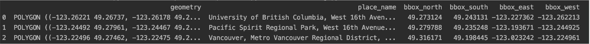

## Announcements

- Project 2 (Game of Life) due **Monday November 16.**
- No lab or POTW this week.
  - Next week: Lab 9 (dynamic programming) and POTW 9 (potpourri) due Sunday Nov 22.
- Practice Examlet 4 is available.
  - Examlet 4 window is Thursday Nov 19 to Monday Nov 23.

- Feeling overwhelmed?  You are not alone!
  - Visit [student health services'](https://students.ubc.ca/health/) [mental health resources](https://students.ubc.ca/health/mental-health-care-ubc/).


## Sudoku

Finish slides from previous lecture.

## Graphs

We have seen graphs and corresponding algorithms for:

| Data | Task | Algorithm |
|------|------|-----------|
| Images / grids | Voronoi diagrams / flood fill | breadth first search |
| Music / evolving systems | sampling / simulation | Markov chains |
| Games | path to solution | depth first search |

Next few lectures:

- Look at geospatial data / maps,
- For the purpose of path planning / route finding,
- Using a dynamic programming algorithm.

::: notes
In this lecture we are going to:

- Work through features of a geospatial data source.
- Introduce the shortest path problem for graphs.
- Introduce an algorithm for solving the shortest path problem.
:::

# Maps {background-image="/images/maps1data.png" background-opacity=0.6}

## Geographic Applications {background-image="/images/maps1data.png" background-opacity=0.3}

- Geospatial data is often stored as a graph.
  - Nodes are features of interest.
  - Edges are physical or logical connections between features.

- In geospatial data sets, nodes often have associated location information.

- When thinking of the data set as a graph, location information may be:
  - Directly useful for visualization.
  - Only indirectly (or not at all) useful for choosing and implementing an appropriate graph algorithm.

::: notes
- Example nodes: intersections, buildings, transit stops, stores, etc.
- Example edges: a road between two intersections, or a store contained within a building.
- Location information: latitude and longitude for road intersections, address for a building.

Takeaway: Think of the data as a labelled graph first, and a human readable map second.
:::


## Open Street Maps

An open-source alternative to the data behind Google / Apple maps:

<https://www.openstreetmap.org/>

- OSM stores raw geographic data (such as intersections, roads, tags, ...).
- OSM has an *application programming interface* (API) through which we can request that data.

``` python
import osmnx as ox

place_names = ['UBC','Vancouver','Stanley Park']
ox.geocode_to_gdf(place_names)
```


::: notes
OSM’s data is contributed collaboratively by volunteers -- like Wikipedia for maps.
:::

## From Maps to Graphs

- NetworkX package provides for storing and manipulating graphs.
- Access OSM data through the NetworkX interface using `osmnx` module.
- In particular, we can extract the road network as a graph where:
  - Nodes are intersections (with lat/long coordinates).
  - Edges are roads with attributes (length, max speed, etc.).
- We will apply graph algorithms to find routes or substructures.
- We will visualize results using Matplotlib or Folium.

::: notes
- We will be extracting the data into *geo dataframes* (gdf).  We will often need to do some manipulation (filtering, mapping) to assemble the right data in the right format.
- NetworkX / osmnx have many graph algorithms built-in, but we still need to identify the right algorithm to solve our problem.
- Matplotlib for static viz, Folium for interactive viz.  Other options are available.
:::

## Introductory Demo {.activity}

Open today's activity.  You will:

- Download map data for Vancouver and the Endowment Lands.
- Explore amenities within that map.
- Create a shortest path route between two locations in the map.
- Visualize everything as both static and interactive maps.

Launch [Class Activity: Fun with Open Street Maps](https://us.prairielearn.com/pl/course_instance/228149/assessment/2722881/) in PrairieLearn.


