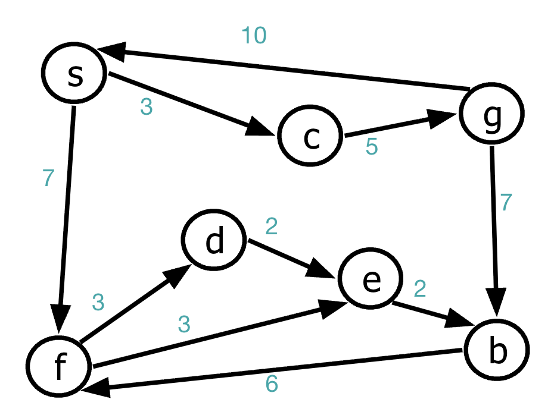
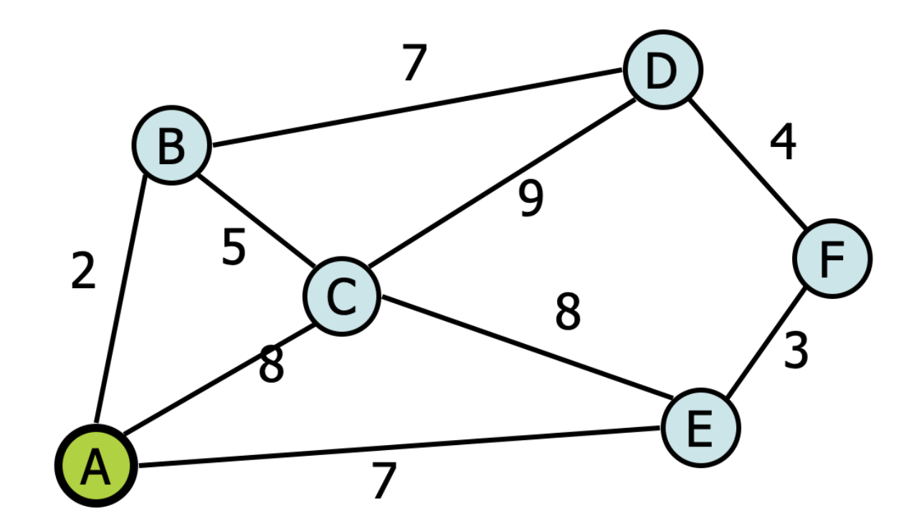

## Announcements

- Project 3 (Campus Walks) due **Monday December 7.**
  - Take a breather.  Get started on this project next week.
- This week: Lab 9 (dynamic programming) and POTW 9 (potpourri) due Sunday Nov 22.
- Examlet 4 window is Thursday Nov 19 to Monday Nov 23.

- Feeling overwhelmed?  You are not alone!
  - Visit [student health services'](https://students.ubc.ca/health/) [mental health resources](https://students.ubc.ca/health/mental-health-care-ubc/).

# Single Source Shortest Path Continued

## Reminder: Dijkstra's Algorithm (1959)

::::: columns
::: {.column}

:::
::: {.column}

1. Initialize structure:
   - Distance to each vertex.
   - Predecessor of each vertex.

2. Repeat these steps:
   - Choose vertex $v$ whose shortest distance has been found.
   - Update $v$’s neighbors with improved distance (and predecessor).
:::
::::: 

::: notes
How do we initialize the distance and predecessor?  Infinity and no predecessor.
How do we identify $v$?  Unvisited vertex with the minimum value.  Why?
Why do we need to record the predecessor?  To build $G'$.
:::

## Implementing Dijkstra: Initialization

::::: columns
::: {.column width=60%}
- For all `v`, 
  - `d[v] = ` 
  - `p[v] = `

- For the source `s`:
  - `d[s] = ` 
  - `p[s] = `
:::
::: {.column width=40%}

:::
::::: 

::: notes
- `d[v] = float('inf')`
- `p[v] = None`
- `d[s] = 0`
- `p[s] = None` (or just leave it the same).
:::

## Implementing Dijkstra: Loop

::::: columns
::: {.column width=60%}
- Repeat until all nodes visited:
  - Find unvisited `v` with smallest `d[v]`
  - Mark `v` as visited
  - For all unvisited neighbors `w` of `v`: 
    - If (_________________ < `d[w]`):
      - `d[w] =` 
      - `p[w] =`
:::
::: {.column width=40%}

:::
::::: 

::: notes
- `d[w] = d[v] + weight[v,w]`
- `p[w] = v`
:::

## Dijkstra's Algorithm in Python {.activity}

Launch [Class Activity: Dijkstra's Algorithm](https://us.prairielearn.com/pl/course_instance/228149/assessment/2750355/) in PrairieLearn.

::::: columns
::: {.column}
You will:

- Write some Python to implement Dijkstra's algorithm.
- Test the implementation on the graph at right.

:::
::: {.column}

:::
:::::

## Comparing Graph Exploration Algorithms {.medium}

::::: columns
::: {.column}
- Initialize structure (see previous slide).
- Repeat until all nodes visited:
  - Find unvisited `v` with smallest `d[v]`
  - Mark `v` as visited
  - For all unvisited neighbors `w` of `v`: 
    - If (`d[v] + weight[v,w] < d[w]`):
      - `d[w] = d[v] + weight[v,w]`
      - `p[w] = v`
:::
::: {.column}

- How is the algorithm similar to BFS/DFS?

\

\

\

- How is the algorithm different from BFS/DFS?
:::
::::: 

## Several Ways of Exploring a Graph

| Property | DFS | BFS | Dijkstra |
|----------|-----|-----|----------|
| Data Structure | stack | queue | priority queue |
| Edge costs? | ignored | all equal | any non-negative |
| Shortest path? | no | yes | yes |
| Frontier | dive deep | explore in layers | explore by shortest known distance |

## Resources

* REALLY great example: <https://www.youtube.com/watch?v=wsSEKm-rU6U>

* OSMNX reference: <https://github.com/gboeing/osmnx-examples>

* Tutorial: <https://gist.github.com/psychemedia/b49c49da365666ba9199d2e27d002d07> 

* Tags: <https://wiki.openstreetmap.org/wiki/Map_features>
