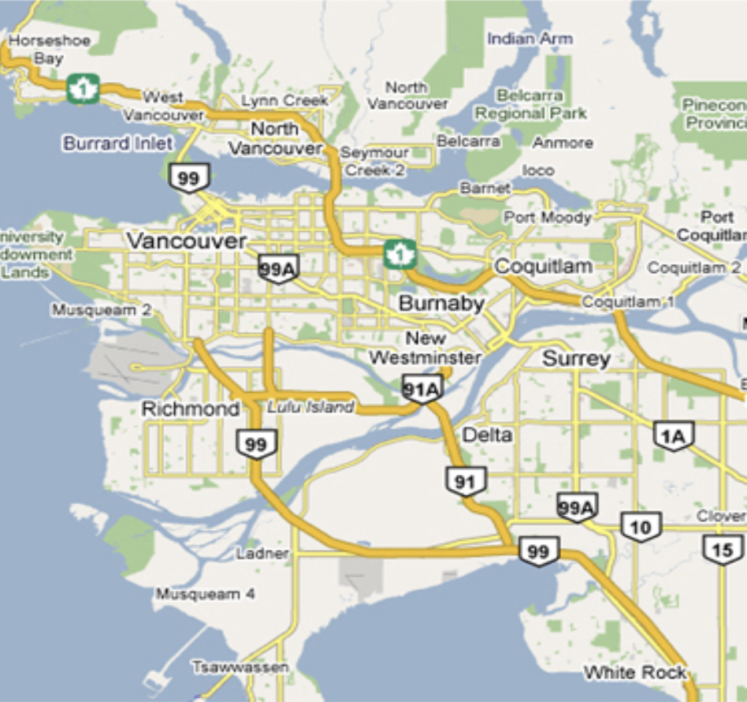
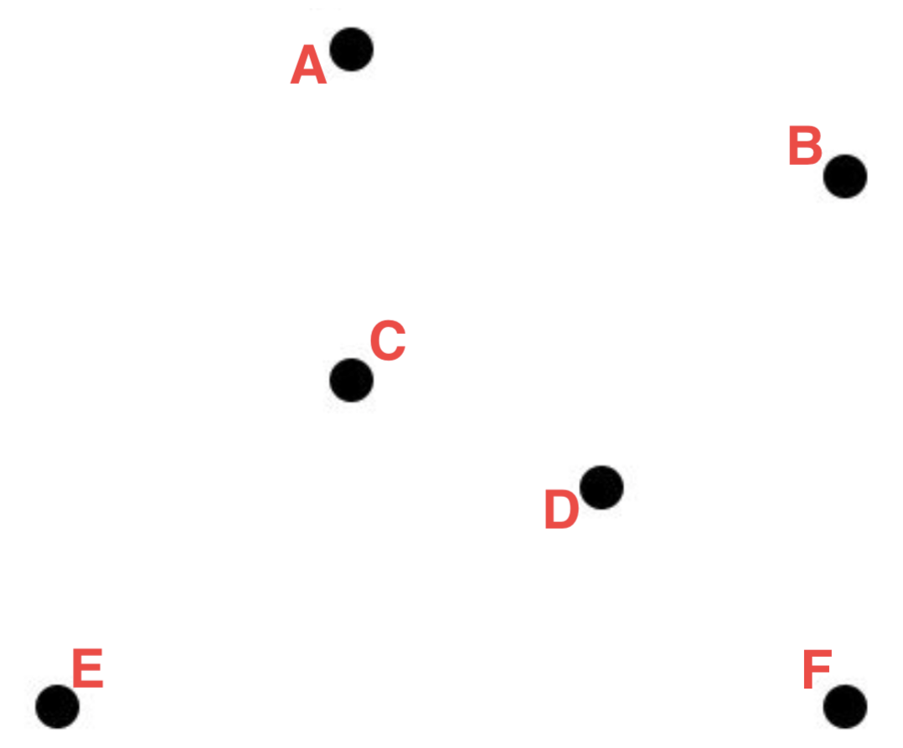
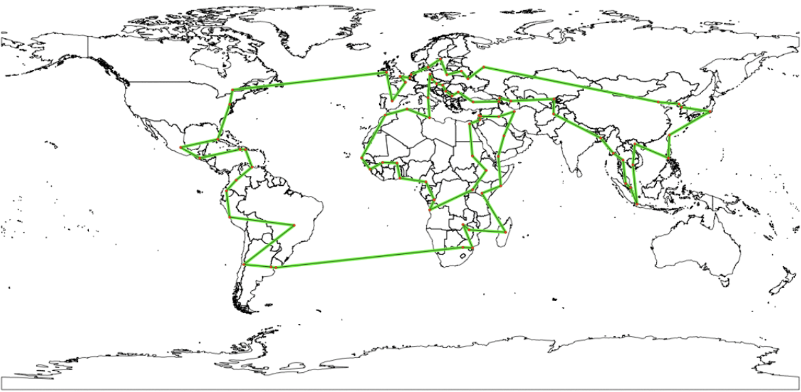

## Announcements

- Project 3 (Campus Walks) due **Monday December 7.**
  - Take a breather.  Get started on this project next week.
- This week: Lab 9 (dynamic programming) and POTW 9 (potpourri) due Sunday Nov 22.
- Examlet 4 window is Thursday Nov 19 to Monday Nov 23.

- Feeling overwhelmed?  You are not alone!
  - Visit [student health services'](https://students.ubc.ca/health/) [mental health resources](https://students.ubc.ca/health/mental-health-care-ubc/).

## Single Source Shortest Path

Finish slides and code implementing Dijkstra's algorithm for SSSP problem
from last class.

# Travelling Salesperson Problem (TSP)

## Maps: Running Errands

- You've got six errands to run. What order do you do them in?
- Determine the least *cost* route through a set of given locations.

::::: columns
::: {.column}
{width="75%" fig-align="center"}
:::
::: {.column}
{width="75%" fig-align="center"}
:::
:::::

::: notes
- Label the nodes.
- A path will be a sequence of nodes.  Start node may or may not be repeated but a closed loop is assumed.
- Observe that direction through the path and where we start doesn't matter.
- Path length is sum of distances between each consecutive pair in the path (plus back to start if omitted).
:::

## [Travelling Salesperson Problem](https://en.wikipedia.org/wiki/Travelling_salesman_problem) (TSP)

"Given a list of cities, and the distances between each pair of cities, what is the shortest possible route that visits each city exactly once and returns to the origin city?" 

- Classic problem on graphs.
- No efficient (eg: polynomial time) algorithmic solution is known.
  - No efficient way to tell if an answer is the best possible one!
- Efficient sub-optimal versions exist; for example,
  - Restricted classes of graphs.
  - Almost optimal solutions.
  - Probabilistically optimal solutions.

::: notes
- Historically called "travelling salesman" for reasons of historical gender roles, but we'll try to be gender-neutral.
  - This formal version first studied in 1930s, but people have been solving this problem since [before there were people](https://en.wikipedia.org/wiki/Travelling_salesman_problem#Human_and_animal_performance).
- How do we know distances between locations?
  - Use SSSP once for each location on the road map.  Expensive, but still polynomial time.
- Optimal algorithm infeasible for even modest number of cities.
  - Even quantum computer doesn't appear to offer polynomial time solution!
- Falls in to class "NP-hard", meaning it is at least as hard as an NP-complete problem, but might be harder.
  - Determining whether a tour exists which satisfies a given length bound is NP-complete (easy to check given a proposed solution).
:::

## Why is the problem so hard?

- How many different candidate solutions are there for six locations? 
- Generalize to k locations?

::::: columns
::: {.column}
{width="75%" fig-align="center"}
:::
::: {.column}
::: center
Possible solutions
:::
:::
:::::

::: notes
- 6 possible starting nodes, 5 next nodes, 4 next nodes, ...
- Result is $k!$, which grows faster than any *fixed exponential* in $k$ (exponentially fast).
  - Stirling's formula: $n! \sim \sqrt{2\pi n}(n/e)^n$
::: 

## "Solving" TSP in Practice: A Blog Adventure

<https://medium.com/data-science/around-the-world-in-90-414-kilometers-ce84c03b8552>

{fig-align="center"}

::: notes
- Not known whether this is the optimal path, but it is feasible and better than many alternatives...
:::

## Why This Matters {.smaller}

There are *lots* of applications:

- 📦 UPS/FedEx/Amazon Delivery: Millions saved by reducing even 1km per driver per day.
- 🍔 UberEats/DoorDash/Skip: Multi-stop pickup/delivery with time windows.
- 🚌 School Bus Routing: Minimize buses, fuel, and time while meeting constraints.
- ❄️ Snowplow & Garbage Truck Routing: Efficiently cover every street in a city.
- ✈️ Airline Crew Scheduling: Complex daily routing: crews must return to base, meet rest rules.
- 🌍 City Infrastructure Planning: Utility inspections, meter reading, streetlight repair routes.
- 🚑 Ambulance & Emergency Routing: Minimize response times; life-critical optimization.
- 🏭 Factory Robots & CNC Machines: Optimizing tool paths reduces waste, heat, and wear.
- 🧪 Medical Lab Sample Pipelines: Robotic arms schedule efficient multi-station workflows.
- 🧬 DNA Sequencing & Genome Assembly: Ordering fragments relies on TSP-like reconstruction.
