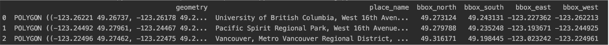
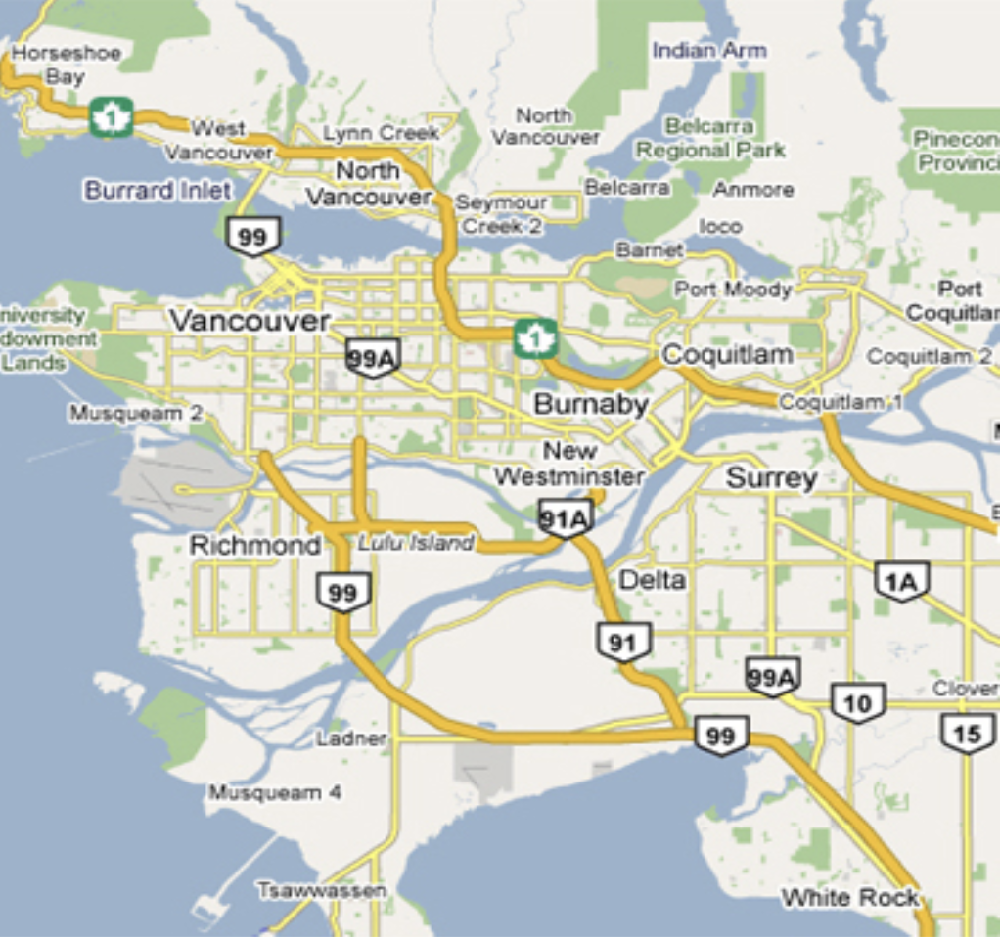
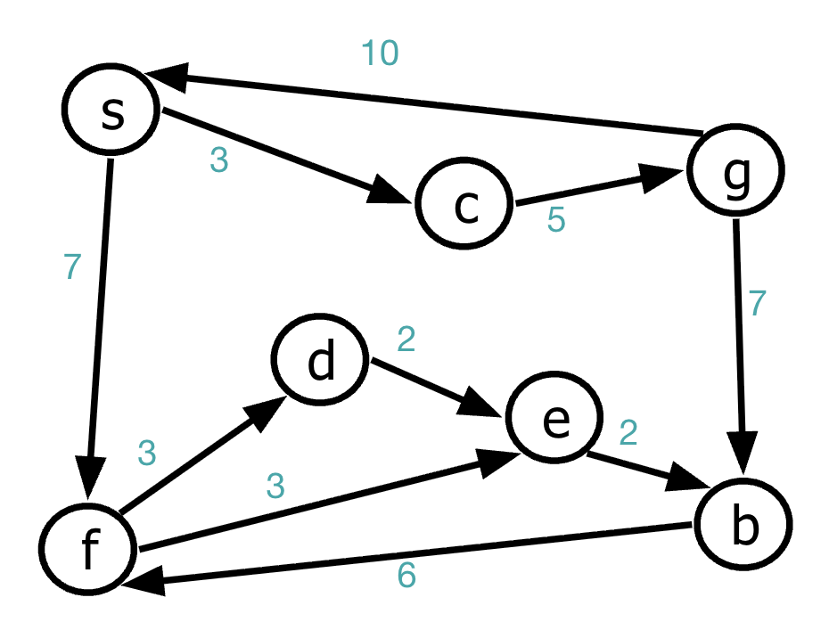
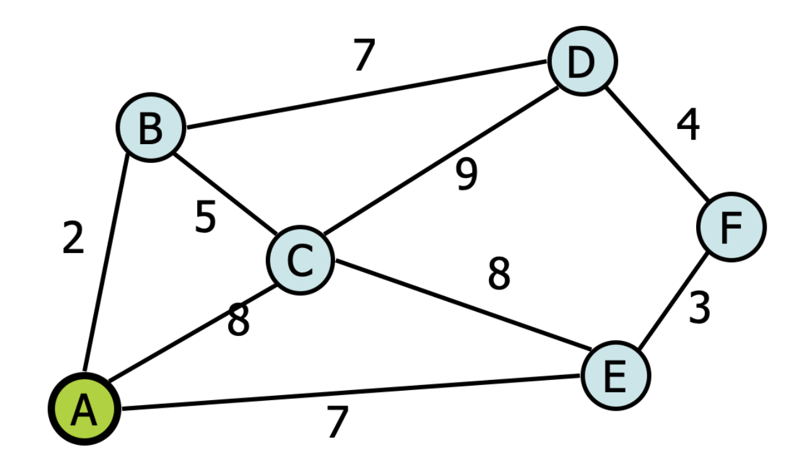

## Announcements

- Project 3 (Campus Walks) due **Monday December 7.**
  - Take a breather.  Get started on this project next week.
- This week: Lab 9 (dynamic programming) and POTW 9 (potpourri) due Sunday Nov 22.
- Examlet 4 window is Thursday Nov 19 to Monday Nov 23.

- Feeling overwhelmed?  You are not alone!
  - Visit [student health services'](https://students.ubc.ca/health/) [mental health resources](https://students.ubc.ca/health/mental-health-care-ubc/).

## Graphs

We have seen graphs and corresponding algorithms for:

| Data | Task | Algorithm |
|------|------|-----------|
| Images / grids | Voronoi diagrams / flood fill | breadth first search |
| Music / evolving systems | sampling / simulation | Markov chains |
| Games | path to solution | depth first search |

Next few lectures:

- Look at geospatial data / maps,
- For the purpose of path planning / route finding,
- Using a dynamic programming algorithm.

::: notes
In this lecture we are going to:

- Work through features of a geospatial data source.
- Introduce the shortest path problem for graphs.
- Introduce an algorithm for solving the shortest path problem.
:::

# Maps {background-image="/images/maps1data.png" background-opacity=0.6}

## Geographic Applications {background-image="/images/maps1data.png" background-opacity=0.3}

- Geospatial data is often stored as a graph.
  - Nodes are features of interest.
  - Edges are physical or logical connections between features.

- In geospatial data sets, nodes often have associated location information.

- When thinking of the data set as a graph, location information may be:
  - Directly useful for visualization.
  - Only indirectly (or not at all) useful for choosing and implementing an appropriate graph algorithm.

::: notes
- Example nodes: intersections, buildings, transit stops, stores, etc.
- Example edges: a road between two intersections, or a store contained within a building.
- Location information: latitude and longitude for road intersections, address for a building.

Takeaway: Think of the data as a labelled graph first, and a human readable map second.
:::


## Open Street Maps

An open-source alternative to the data behind Google / Apple maps:

<https://www.openstreetmap.org/>

- OSM stores raw geographic data (such as intersections, roads, tags, ...).
- OSM has an *application programming interface* (API) through which we can request that data.

``` python
import osmnx as ox

place_names = ['UBC','Vancouver','Stanley Park']
ox.geocode_to_gdf(place_names)
```


::: notes
OSM’s data is contributed collaboratively by volunteers -- like Wikipedia for maps.
:::

## From Maps to Graphs

- NetworkX package provides for storing and manipulating graphs.
- Access OSM data through the NetworkX interface using `osmnx` module.
- In particular, we can extract the road network as a graph where:
  - Nodes are intersections (with lat/long coordinates).
  - Edges are roads with attributes (length, max speed, etc.).
- We will apply graph algorithms to find routes or substructures.
- We will visualize results using Matplotlib or Folium.

::: notes
- We will be extracting the data into *geo dataframes* (gdf).  We will often need to do some manipulation (filtering, mapping) to assemble the right data in the right format.
- NetworkX / osmnx have many graph algorithms built-in, but we still need to identify the right algorithm to solve our problem.
- Matplotlib for static viz, Folium for interactive viz.  Other options are available.
:::

## Open Street Maps Demo {.activity}

You will:

- Download map data for Vancouver and the Endowment Lands.
- Explore amenities within that map.
- Create a shortest path route between two locations in the map.
- Visualize everything as both static and interactive maps.

Launch [Class Activity: Fun with Open Street Maps](https://us.prairielearn.com/pl/course_instance/228149/assessment/2722881/) in PrairieLearn.

# Single Source Shortest Path

## Single Source Shortest Path

::::: columns
::: {.column width=40%}

:::
::: {.column width=60%}
- Given: a starting vertex (*source* or *root*) $s$.
- Find: paths of least total cost from $s$ to every vertex in the graph.

What if we have a specific destination vertex?

- Modify the algorithm (called "A*").
  - Asymptotic cost is the same.
  - Actual run-time is better
  - More complicated code.
:::
::::: 

## SSSP Example {.medium}

- Input: Weighted graph $G$ and a start vertex $s$.
  - Edge weights of $G$ must be non-negative.
- Output: A subgraph $G’$ consisting of the shortest (minimum total cost) paths from $s$ to every other vertex in the graph.

::::: columns
::: {.column}
<center>

</center>
:::
::: {.column}

:::
::::: 

::: notes
Draw $G'$.

- What if the edges are undirected?
- What if the weights are negative?
  - change (d,e) to -2: DIJK may not find shortest path
  - change (g,s) to -10: no shortest path exists
:::

## Dijkstra's Algorithm (1959)

::::: columns
::: {.column}

:::
::: {.column}

1. Initialize structure:
   - Distance to each vertex.
   - Predecessor of each vertex.

2. Repeat these steps:
   - Choose vertex $v$ whose shortest distance has been found.
   - Update $v$’s neighbors with improved distance (and predecessor).
:::
::::: 

::: notes
How do we initialize the distance and predecessor?  Infinity and no predecessor.
How do we identify $v$?  Unvisited vertex with the minimum value.  Why?
Why do we need to record the predecessor?  To build $G'$.
:::

## Implementing Dijkstra: Initialization

::::: columns
::: {.column width=60%}
- For all `v`, 
  - `d[v] = ` 
  - `p[v] = `

- For the source `s`:
  - `d[s] = ` 
  - `p[s] = `
:::
::: {.column width=40%}


:::
::::: 

::: notes
- `d[v] = float('inf')`
- `p[v] = None`
- `d[s] = 0`
- `p[s] = None` (or just leave it the same).
:::


## Implementing Dijkstra: Loop

::::: columns
::: {.column width=60%}
- Repeat until all nodes visited:
  - Find unvisited `v` with smallest `d[v]`
  - Mark `v` as visited
  - For all unvisited neighbors `w` of `v`: 
    - If (_________________ < `d[w]`):
      - `d[w] =` 
      - `p[w] =`
:::
::: {.column width=40%}


:::
::::: 

::: notes
- `d[w] = d[v] + weight[v,w]`
- `p[w] = v`
:::

## Dijkstra's Algorithm in Python {.activity}

Launch [Class Activity: Dijkstra's Algorithm](https://us.prairielearn.com/pl/course_instance/228149/assessment/2750355/) in PrairieLearn.

::::: columns
::: {.column}
You will:

- Write some Python to implement Dijkstra's algorithm.
- Test the implementation on the graph at right.

:::
::: {.column}

:::
:::::


## Comparing Graph Exploration Algorithms {.medium}

::::: columns
::: {.column}
- Initialize structure (see previous slide).
- Repeat until all nodes visited:
  - Find unvisited `v` with smallest `d[v]`
  - Mark `v` as visited
  - For all unvisited neighbors `w` of `v`: 
    - If (`d[v] + weight[v,w] < d[w]`):
      - `d[w] = d[v] + weight[v,w]`
      - `p[w] = v`
:::
::: {.column}

- How is the algorithm similar to BFS/DFS?

\

\

\

- How is the algorithm different from BFS/DFS?
:::
::::: 

## Several Ways of Exploring a Graph

| Property | DFS | BFS | Dijkstra |
|----------|-----|-----|----------|
| Data Structure | stack | queue | priority queue |
| Edge costs? | ignored | all equal | any non-negative |
| Shortest path? | no | yes | yes |
| Frontier | dive deep | explore in layers | explore by shortest known distance |


## Resources

* REALLY great example: <https://www.youtube.com/watch?v=wsSEKm-rU6U>

* OSMNX reference: <https://github.com/gboeing/osmnx-examples>

* Tutorial: <https://gist.github.com/psychemedia/b49c49da365666ba9199d2e27d002d07> 

* Tags: <https://wiki.openstreetmap.org/wiki/Map_features>
