## Announcements

- Project 3 (Campus Walks) due **Monday December 7**.  Time to get started.
- This week: Lab 10 (algorithm complexity) and POTW 10 (permutations) due Sunday Nov 29.
  - Next week: (most) lab sessions open as office hours.
- Practice Examlet 5 is available.
  - Examlet 5 window is Thursday December 3 to Monday December 7 (after last lecture).

- Feeling overwhelmed?  You are not alone!
  - Visit [student health services'](https://students.ubc.ca/health/) [mental health resources](https://students.ubc.ca/health/mental-health-care-ubc/).

# Text as Data: Examples

## Visualizing Literature

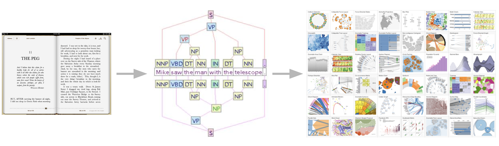

::: notes
- A book is (mostly) a list of words.
- We can process those words in various ways, and then produce various visualizations of the results.
:::

## Lexical Novelty {.medium}

::::: columns 
::: {.column width="60%"}
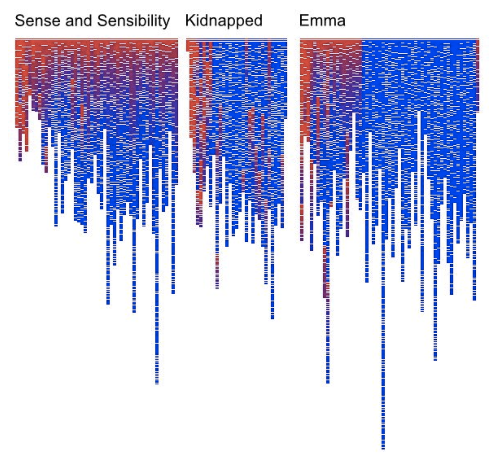
:::
::: {.column width="40%"}
- Each column is a chapter containing paragraphs.
- Red indicates paragraphs containing many new terms.
:::
:::::


::: notes
- A paragraph with more than 25% new terms (words not yet observed) is set to 1 (red)
- Decays linearly to 0 (blue) if fewer new terms are seen.
<!--
"Novels are full of new characters, new locations and new expressions. The discourse between characters involves new ideas being exchanged. We can get a hint of this by tracking the introduction of new terms in a novel. In the below visualizations (in which each column represents a chapter and each small block a paragraph of text), I maintain a variable which represents novelty. When a paragraph contains more than 25% new terms (i.e. words that have not been observed thus far) this variable is set at its maximum of 1. Otherwise, the variable decays. The variable is used to colour the paragraph with red being 1.0 and blue being 0. The result is that we can get an idea of the introduction of new ideas in novels."  - Matthew Hurst
-->
:::

## Word Co-occurrence 

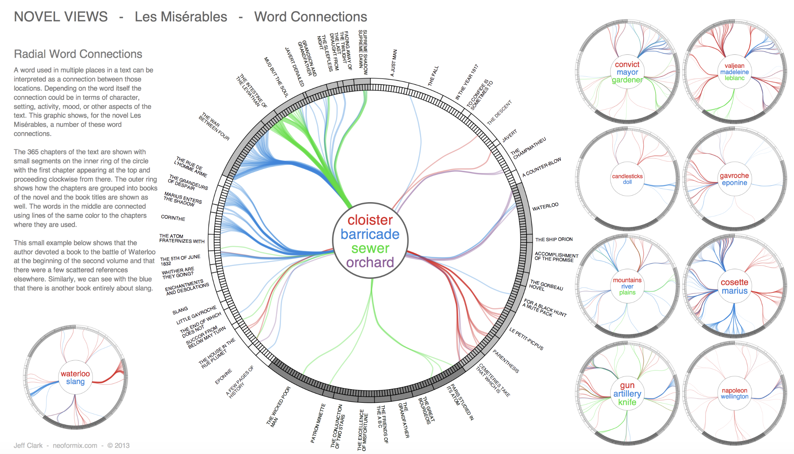{fig-align="center"}

::: notes
- Where do words appear in the text of Les Miserables?
- Chapters start at noon and progress clockwise.  Titles of books are shown.
:::

## Cross References

{fig-align="center"}

<center>
[cross references in the King James Bible](https://www.chrisharrison.net/index.php/visualizations/BibleViz)
</center>

::: notes
- These are 63,779 manually identified cross references of "conceptual links between verses, connecting locations, people, phrases, etc."
- One bar for each chapter, with length equal to number of verses.  Books alternate light and dark grey, with first books of old and new testaments in white.
- Arc colour is distance between the references.
- Primarily designed to look pretty.
:::

## Sentiment Analysis

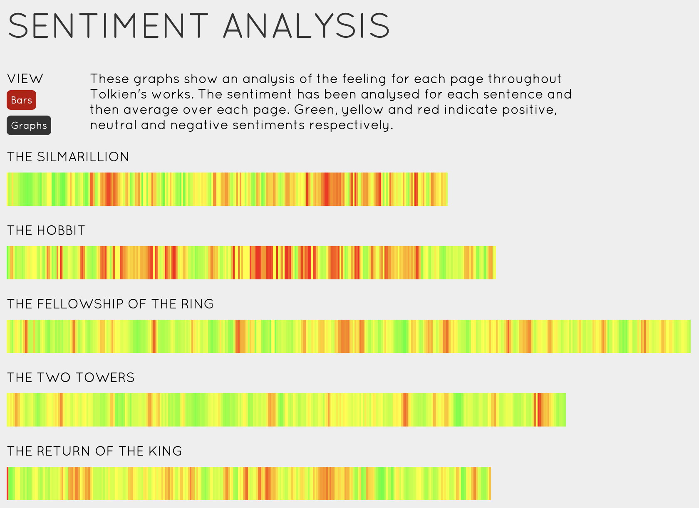{fig-align="center"}

<center>
[Sentiment Analysis](http://lotrproject.com/statistics/books/sentimentanalysis) from the [LOTR Project](http://lotrproject.com/)
</center>

::: notes
- Okay, maybe the Hobbit is not a children's book...
:::

## Mapping the Hero's(?) Journey

::: {.columns}

::: {.column}
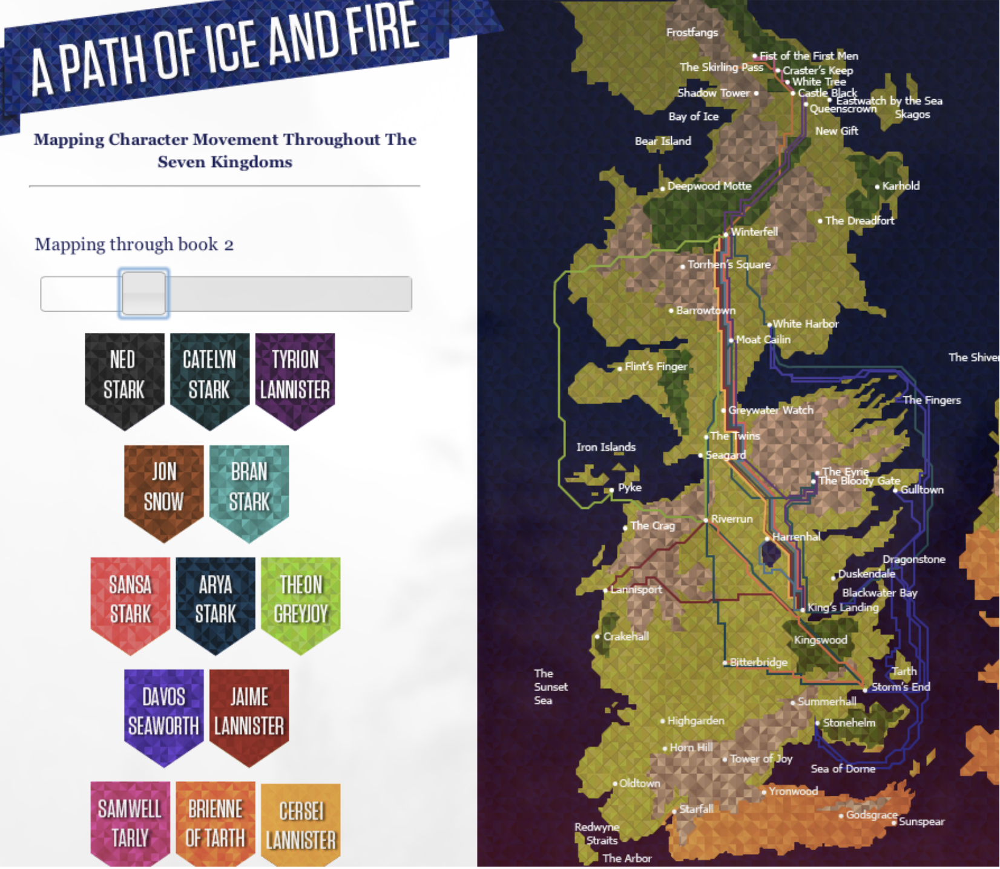{fig-align="center"}
:::

::: {.column}
Visualization at left by a former student of Cinda's.

Alternatively, see [Interactive Game of Thrones Map](https://quartermaester.info/).
:::

:::

::: notes
- Requires more than just the text: Where would we get a geographic data source for the map?
- Automatically extracting the location information for the characters seems tricky...
:::

# Text as Data: A Processing Pipeline

## Visualizing Literature

- A novel is just a long sequence of characters.
- If we treat it as data, we can:
  - Count and visualize patterns,
  - Compare books or authors,
  - Build networks of characters and concepts.
  - ...
- Today: turn a novel into numbers and pictures.

<!--
## What Can We Compute From a Book? {.activity}

If I give you the full text of a novel as a `.txt` file

  - What **questions** could we ask?
  - What **numbers** or **graphs** could we compute?

Ideas:
-->

## The Text-as-Data Pipeline {.medium}

::: {.columns}

::: {.column}
**Common data flow steps**

1. Load the text from a file.
2. *Tokenize*: Split into words.
3. **Preprocess**:
   - convert to lowercase
   - remove punctuation
   - remove *stopwords*
   - use *lemmas*
:::

::: {.column}
**Subsequent data flow options**

- Process: 
  - Word frequencies.
  - Parts of speech.
  - Cross references.
  - Named entities (people, places, ...)
  - ...
- Visualize: Static or interactive.
- Interpret:
  - What do the results tell us?
  - Do we need to refine and repeat?
:::

:::

## Load the Text

For example: [Project Gutenberg Canada](https://gutenberg.ca/PGCA-welcome/).

``` {pyodide}
import requests

url = "https://raw.githubusercontent.com/UBC-CS/cpsc203/main/data/ofk.txt"

resp = requests.get(url)
resp.raise_for_status()   # optional but good practice
text = resp.text          # this is your whole file as one big string

print(text[:500])  # peek at the first 500 characters
```

We'll use a local copy of [*The Once and Future King*](https://raw.githubusercontent.com/UBC-CS/cpsc203/main/data/ofk.txt) by T. H. White.

::: notes
- Link is for "Once and Future King" by T.H.White about the legend of King Arthur (includes "The Sword and the Stone").
- This step may be non-trivial for material still subject to copyright.
  - Unless you are an AI company; apparently they can scrape anything they want...
:::

## Tokenization

Break the text into words (or phrases, sentences, paragraphs, ...) for subsequent processing.


``` {pyodide}
excerpt = text[1801:2093]  # Some subset of the text for this example.
print(excerpt + '\n\n')
print(excerpt.split())
```

::: notes
- We often start by breaking into words because that is relatively easy in modern text.
  - Note that using spaces between words was an invention, first in seventh century BCE Aramaic but only arrived in western practice in seventh century CE when Irish & Anglo-Saxon monks started using it in Latin texts.
  - Next lecture we will see how we start to put the words back together into larger tokens.
- Things to note:
  - Punctuation gets appended to words.
  - Python uses double quote delimiter when a string contains single quotes (see `Kay's`).
  - Multiple ways of referring to the same person: governess and she/her; Kay, Kay's and Sir Kay.
:::

## Example of Tokenized Text

::::: columns
::: {.column width=50%}

\ 

\ 

Visualized: The thirty most common tokens in the mystery text.
:::
::: {.column width=50%}
{fig-align="center"}
:::
:::::

::: notes
- We used a fancier tokenizer than `str.split()`.
- But we are still getting a *lot* of punctuation, and a lot of words which don't tell you much about the text.
:::

## We Need to *Pre-Process*


::: {.columns}

::: {.column width=40%}
Actual data often contains [*cruft*](https://en.wikipedia.org/wiki/Cruft).

Removal of cruft often requires iterative manual experimentation.
:::

::: {.column width=60%}
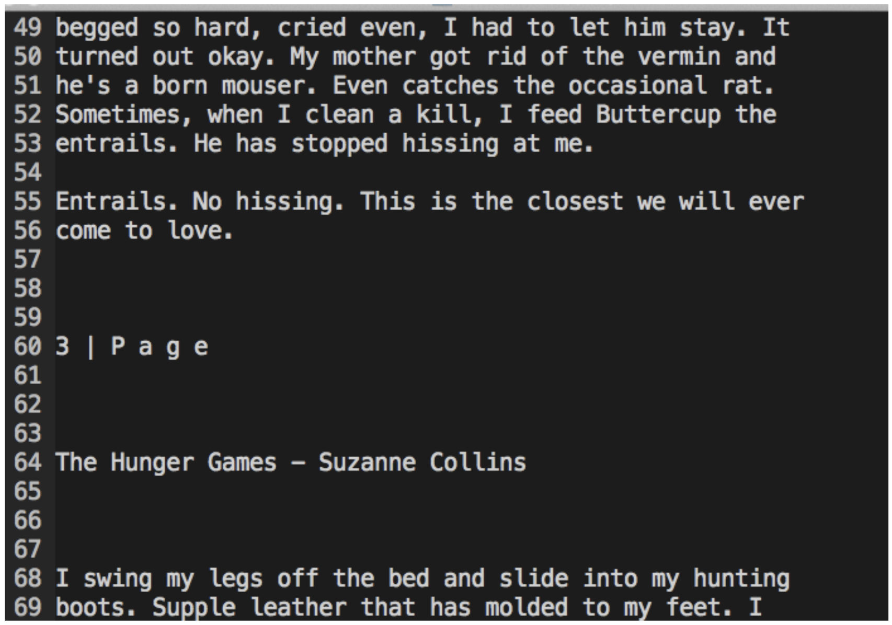{fig-align="center"}

::: {style="font-size: 0.7em; text-align: center;"}
(not our mystery text)
:::

:::

:::

::: notes
- In this case, we want to remove the "3 | Page" and "The Hunger Games - Suzanne Collins" lines.
  - Why on earth are they labelling "pages" in an e-book?
  - Note: The pre-processing steps we will discuss won't remove this type of cruft -- that often has to be done manually.  But the pre-processing may make it easier (eg: "Suzanne Collins", but probably not "Hunger Games").
- Fortunately, our example text appears relatively free of cruft: There is the header / title page stuff, chapter titles, and not much else.
:::

## spaCy for Natural Language Processing

We will use the [spaCy](https://spacy.io/usage/spacy-101) open source library.

- Support for many languages.
- Rule-based tokenizer.
- Pre-processing uses a combination of rule-based and learned statistical models.
- Processing features use learned statistical models.
- Learned models (and rules) can be updated if desired.

::: notes
- "Rule-based" means human designed algorithms, while "statistical models" means machine learning based on training data.
- Pre-processing: convert to lower case, remove stop words, eliminate punctuation (rule-based), lemmatization (statistical).
- Processing: part-of-speech tagging, dependency parsing, named entity recognition, text classification and similarity.
  - See next lecture.
:::


## Example Pre-Processing Sequence: Convert Case

<center>
<svg xmlns="http://www.w3.org/2000/svg"
     width="900" height="100" viewBox="0 0 900 100">
<style>
    .box {
      rx: 15;
      ry: 15;
      stroke: #5b4c8a;
      stroke-width: 2;
    }
    .box-light {
      fill: #e3d7ff;
    }
    .box-mid {
      fill: #c5b2ff;
    }
    .label {
      font-family: "Helvetica", "Arial", sans-serif;
      font-size: 18px;
      text-anchor: middle;
      dominant-baseline: middle;
      fill: #2b2147;
    }
  </style>
  <rect class="box box-light" x="40" y="20" width="160" height="60" />
  <text class="label" x="120" y="50">lower case</text>
  <rect class="box box-mid" x="240" y="20" width="160" height="60" />
  <text class="label" x="315" y="39">eliminate</text>
  <text class="label" x="315" y="61">punctuation</text>
  <rect class="box box-mid" x="440" y="20" width="160" height="60" />
  <text class="label" x="520" y="39">remove stop</text>
  <text class="label" x="520" y="61">words</text>
  <rect class="box box-mid" x="640" y="20" width="80" height="60" />
  <text class="label" x="680" y="50">lemma</text>
</svg>
</center>

::::: columns
::: {.column width=50%}
Should "him" and "Him" be different tokens?

What about "Bob" and "bob"?
:::
::: {.column width=50%}
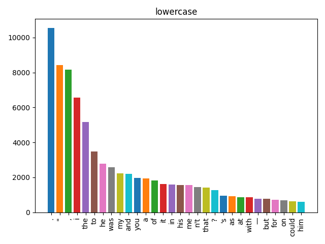{fig-align="center"}
:::
:::::

## Example Pre-Processing Sequence: Remove Punctuation

<center>
<svg xmlns="http://www.w3.org/2000/svg"
     width="900" height="100" viewBox="0 0 900 100">
<style>
    .box {
      rx: 15;
      ry: 15;
      stroke: #5b4c8a;
      stroke-width: 2;
    }
    .box-light {
      fill: #e3d7ff;
    }
    .box-mid {
      fill: #c5b2ff;
    }
    .label {
      font-family: "Helvetica", "Arial", sans-serif;
      font-size: 18px;
      text-anchor: middle;
      dominant-baseline: middle;
      fill: #2b2147;
    }
  </style>
  <rect class="box box-mid" x="40" y="20" width="160" height="60" />
  <text class="label" x="120" y="50">lower case</text>
  <rect class="box box-light" x="240" y="20" width="160" height="60" />
  <text class="label" x="315" y="39">eliminate</text>
  <text class="label" x="315" y="61">punctuation</text>
  <rect class="box box-mid" x="440" y="20" width="160" height="60" />
  <text class="label" x="520" y="39">remove stop</text>
  <text class="label" x="520" y="61">words</text>
  <rect class="box box-mid" x="640" y="20" width="80" height="60" />
  <text class="label" x="680" y="50">lemma</text>
</svg>
</center>

::::: columns
::: {.column width=50%}
Should "father" and "father." be different tokens?

What about "Dr.", "$3.50" or "student(s)"?
:::
::: {.column width=50%}
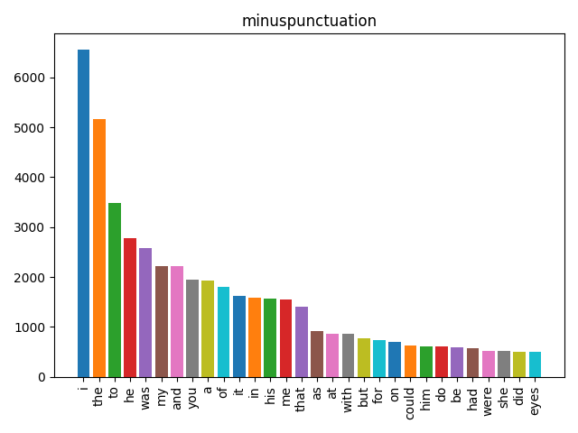{fig-align="center"}
:::
:::::

::: notes
- Most punctuation is present only to make reading easier for humans.
  - Commas, semi-colons, colons, sentence ending periods.
  - Use began eigth century BCE with points to separate words (*not* spaces), formalized ~200 BCE with dots in high/middle/low position to denote short/medium/long pauses.
- Even meaningful punctuation is used only to tag features of accompanying text
  - A period after an abbreviation.
  - An apostrophe in a contraction.
  - Question and exclamation marks.
  - Quotes.
:::


## Example Pre-Processing Sequence: Remove Uninteresting Words

<center>
<svg xmlns="http://www.w3.org/2000/svg"
     width="900" height="100" viewBox="0 0 900 100">
<style>
    .box {
      rx: 15;
      ry: 15;
      stroke: #5b4c8a;
      stroke-width: 2;
    }
    .box-light {
      fill: #e3d7ff;
    }
    .box-mid {
      fill: #c5b2ff;
    }
    .label {
      font-family: "Helvetica", "Arial", sans-serif;
      font-size: 18px;
      text-anchor: middle;
      dominant-baseline: middle;
      fill: #2b2147;
    }
  </style>
  <rect class="box box-mid" x="40" y="20" width="160" height="60" />
  <text class="label" x="120" y="50">lower case</text>
  <rect class="box box-mid" x="240" y="20" width="160" height="60" />
  <text class="label" x="315" y="39">eliminate</text>
  <text class="label" x="315" y="61">punctuation</text>
  <rect class="box box-light" x="440" y="20" width="160" height="60" />
  <text class="label" x="520" y="39">remove stop</text>
  <text class="label" x="520" y="61">words</text>
  <rect class="box box-mid" x="640" y="20" width="80" height="60" />
  <text class="label" x="680" y="50">lemma</text>
</svg>
</center>

::::: columns
::: {.column width=50%}
*Stop Words*: Filter out common and largely unhelpful words.

List of stop words is compiled from a large *corpus* of representative texts.
:::
::: {.column width=50%}
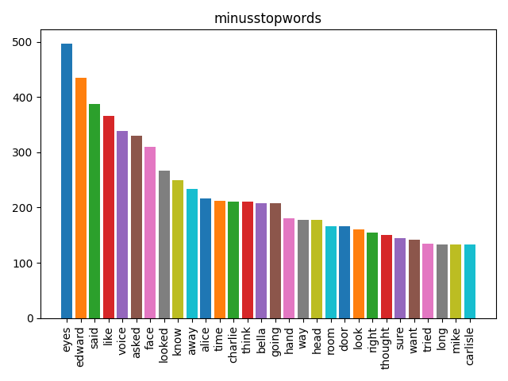{fig-align="center"}
:::
:::::

::: notes
- *Term Frequency–Inverse Document Frequency* (TF-IDF): is a more sophisticated approach for filtering unhelpful words based on the relative frequencies of tokens in both the corpus and the current text; may be combined with stop word filtering.
:::

## Example Pre-Processing Sequence: Lemmatization

<center>
<svg xmlns="http://www.w3.org/2000/svg"
     width="900" height="100" viewBox="0 0 900 100">
<style>
    .box {
      rx: 15;
      ry: 15;
      stroke: #5b4c8a;
      stroke-width: 2;
    }
    .box-light {
      fill: #e3d7ff;
    }
    .box-mid {
      fill: #c5b2ff;
    }
    .label {
      font-family: "Helvetica", "Arial", sans-serif;
      font-size: 18px;
      text-anchor: middle;
      dominant-baseline: middle;
      fill: #2b2147;
    }
  </style>
  <rect class="box box-mid" x="40" y="20" width="160" height="60" />
  <text class="label" x="120" y="50">lower case</text>
  <rect class="box box-mid" x="240" y="20" width="160" height="60" />
  <text class="label" x="315" y="39">eliminate</text>
  <text class="label" x="315" y="61">punctuation</text>
  <rect class="box box-mid" x="440" y="20" width="160" height="60" />
  <text class="label" x="520" y="39">remove stop</text>
  <text class="label" x="520" y="61">words</text>
  <rect class="box box-light" x="640" y="20" width="80" height="60" />
  <text class="label" x="680" y="50">lemma</text>
</svg>
</center>

::::: columns
::: {.column width=50%}
Reduce word to dictionary form (its *lemma*).

- "running" or "ran" -> "run"
- "better" -> "good"
- "geese" -> "goose"
:::
::: {.column width=50%}
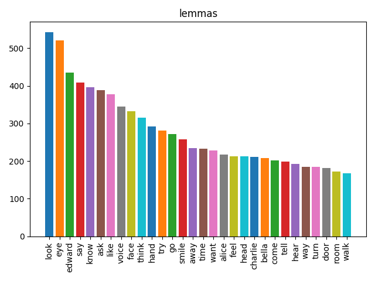{fig-align="center"}
:::
:::::

::: notes
- Gets rid of verb tenses, superlatives and plurals.
:::

## Compare Pre- and Post-Lemmatization

::::: columns
::: {.column}
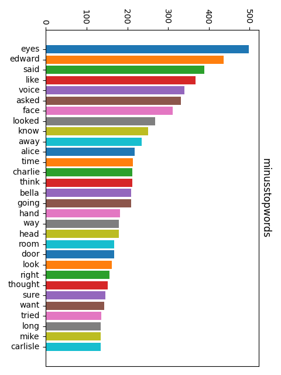{fig-align="center"}
:::
::: {.column}
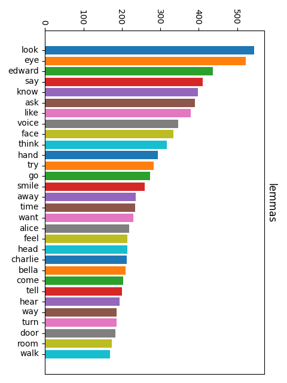{fig-align="center"}
:::
:::::

::: notes
- Notice "look" is now top, whereas "looked" was at eigth and "look" down in the twenties.
- "Eyes" was truncated to "eye".
- "Said" became "say".
- Names "Edward", "Alice", "Charlie" and "Bella" have dropped noticably.
- Can you guess the text?
:::

## Aside: spaCy Representations

- Language class (`nlp`) processes the input text into a Doc object (`doc`).
  - Doc object will keep track of the tokens and their attributes.
  - Processing pipeline will modify the Doc object *in-place*.

- Tokens (and many other entities of interest) represent strings.
  - Strings can take significant memory to store.
  - Actual processing in spaCy is done with the hashes of the strings.
  - Many object attributes will store hashes; append underscore to see original string.

- Don't throw anything away!

::: notes
- Strings take one (or more) byte per character, whereas hash is fixed size (8 bytes).
- Must keep a dictionary mapping hashes back to strings.
- We want to be able to reconstruct the original text if we need to go back to it in order to figure something out.
:::

## Demo {.activity}

Launch [Class Activity: Visualizing Literature](https://us.prairielearn.com/pl/course_instance/228149/assessment/2722861/) in PrairieLearn.

Contains a mystery text and code to demonstrate:

- Tokenization.
- Pre-processing steps: Convert to lower case, eliminate punctuation, remove stop words, and lemmatization.
- Bar chart visualization of most frequent tokens after each step.


