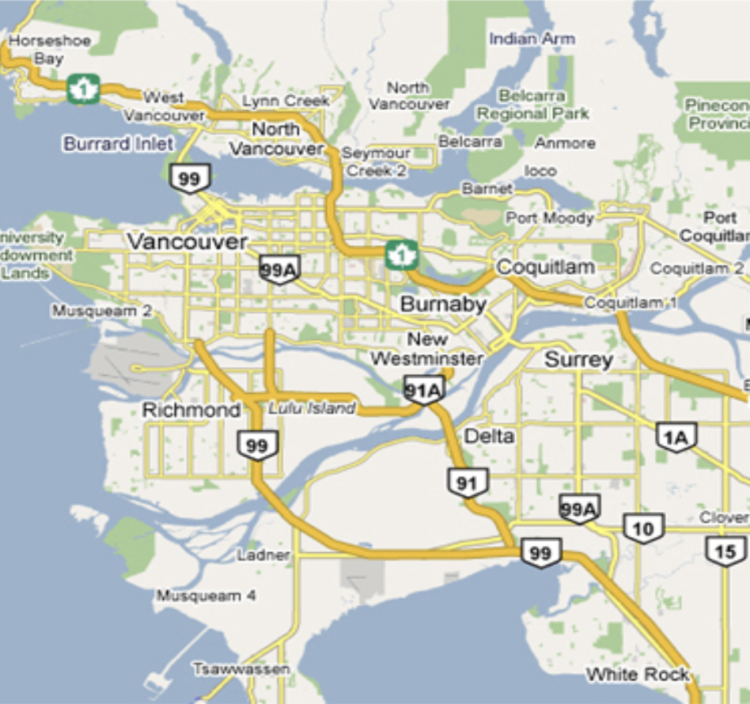
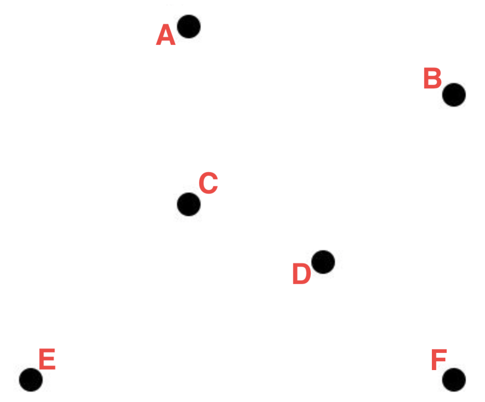
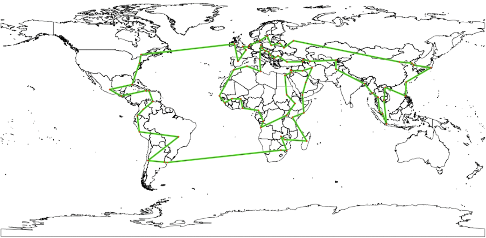
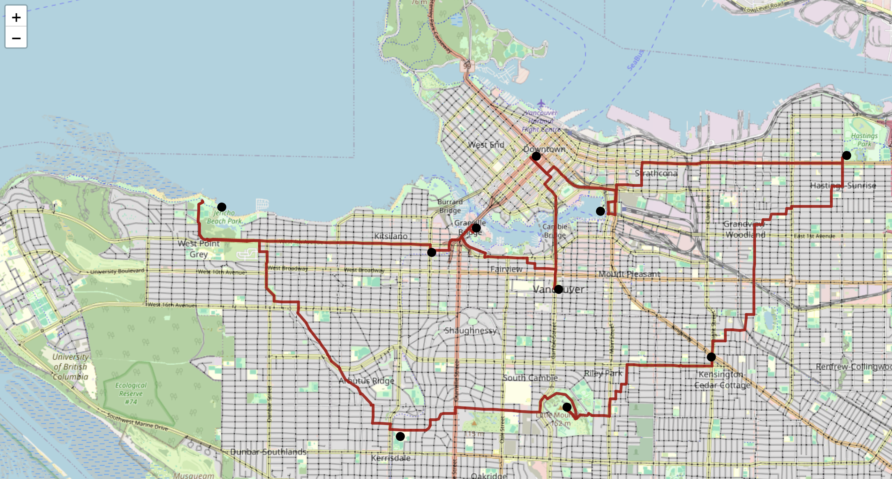

## Announcements

- Project 3 (Campus Walks) due **Monday December 7.**
  - You can get started after this lecture.
- This week: Lab 10 (algorithm complexity) and POTW 10 (permutations) due Sunday Nov 29.
- Practice Examlet 5 is available.
  - Examlet 5 window is Thursday December 3 to Monday December 7 (after last lecture).

- Feeling overwhelmed?  You are not alone!
  - Visit [student health services'](https://students.ubc.ca/health/) [mental health resources](https://students.ubc.ca/health/mental-health-care-ubc/).

# Finishing Dijkstra's Algorithm for SSSP

## Dijkstra's Algorithm: Complexity {.medium}

- Analysis is very similar to that for BFS / DFS:
  - Each node enters the queue a bounded number of times (for Dijkstra: bounded by the number of neighbours).
  - Each time it enters the queue, we need to do a constant amount of work (for Dijkstra: essentially nothing).
  - Each time it exits the queue, we need to do a constant amount of work (for Dijkstra: for each neighbour, check whether there is a better path).

## Reminder: BFS / DFS Complexity {.medium}

- For BFS and DFS, we used a FIFO queue and a LIFO queue (stack) respectively.
  - For FIFO or LIFO queue the work needed to add or remove a item is constant (does not depend on the number of items in the queue).
- Assume: $n$ is the number of nodes in the graph and the maximum number of neighbours is bounded by a constant (it does not depend on $n$).
  - BFS / DFS: For $O(n)$ times, do work $O(1 + 1 + 1 + 1)$ (work *when entering* the queue, work *of entering* the queue, work *of exiting* the queue, work *when exiting* the queue)
  - BFS / DFS: Total cost $O(n)$.

## Dijkstra's Algorithm: Complexity {.medium}

- However, a priority queue takes more work to maintain than a FIFO or LIFO queue.
  - For a priority queue containing $n$ items, the work needed to add or remote an item is $O(\lg n)$ (that work is done to keep track of the item with smallest current priority).
- Assume: $n$ is the number of nodes in the graph and the maximum number of neighbours is bounded by a constant (it does not depend on $n$).
  - Dijkstra: For $O(n)$ times, do work $O(1 + \lg n + \lg n + 1)$ (work *when entering* the queue, work *of entering* the queue, work *of exiting* the queue, work *when exiting* the queue)
  - Dijkstra: Total cost $O(n \lg n)$.

::: notes
- Note that $\lg n$ grows **much** more slowly than even $n$: when you *double* the size of $n$, then $\lg n$ grows by 1.
- Dijkstra is worse than BFS / DFS, but not much worse.
:::

# Travelling Salesperson Problem (TSP)

## Maps: Running Errands

- You've got six errands to run. What order do you do them in?
- Determine the least *cost* route through a set of given locations.

::::: columns
::: {.column}
{width="75%" fig-align="center"}
:::
::: {.column}
{width="75%" fig-align="center"}
:::
:::::

::: notes
- A path will be a sequence of nodes.  Start node may or may not be repeated but a closed loop is assumed.
- Observe that direction through the path and where we start doesn't matter.
- Path length is sum of distances between each consecutive pair in the path (plus back to start if omitted).
:::

## [Travelling Salesperson Problem](https://en.wikipedia.org/wiki/Travelling_salesman_problem) (TSP)

"Given a list of cities, and the distances between each pair of cities, what is the shortest possible route that visits each city exactly once and returns to the origin city?" 

- Classic problem on graphs.
- No efficient (eg: polynomial time) algorithmic solution is known.
  - No efficient way to tell if an answer is the best possible one!
- Efficient sub-optimal versions exist; for example,
  - Restricted classes of graphs.
  - Almost optimal solutions.
  - Probabilistically optimal solutions.

::: notes
- Historically called "travelling salesman" for reasons of historical gender roles, but we'll try to be gender-neutral.
  - This formal version first studied in 1930s, but people have been solving this problem since [before there were people](https://en.wikipedia.org/wiki/Travelling_salesman_problem#Human_and_animal_performance).
- How do we know distances between locations?
  - Use SSSP once for each location on the road map.  Expensive, but still polynomial time.
- Optimal algorithm infeasible for even modest number of cities.
  - Even quantum computer doesn't appear to offer polynomial time solution!
- Falls in to class "NP-hard", meaning it is at least as hard as an NP-complete problem, but might be harder.
  - Determining whether a tour exists which satisfies a given length bound is NP-complete (easy to check given a proposed solution).
:::

## Why is the problem so hard?

- How many different candidate solutions are there for six locations? 
- Generalize to k locations?

::::: columns
::: {.column}
{width="75%" fig-align="center"}
:::
::: {.column}
::: center
Possible solutions
:::
:::
:::::

::: notes
- 6 possible starting nodes, 5 next nodes, 4 next nodes, ...
- Result is $k!$, which grows faster than any *fixed exponential* in $k$ (exponentially fast).
  - Stirling's formula: $n! \sim \sqrt{2\pi n}(n/e)^n$
::: 

## "Solving" TSP in Practice: A Blog Adventure

<https://medium.com/data-science/around-the-world-in-90-414-kilometers-ce84c03b8552>

{fig-align="center"}

::: notes
- Not known whether this is the optimal path, but it is feasible and better than many alternatives...
:::

## Why This Matters {.smaller}

There are *lots* of applications:

- 📦 UPS/FedEx/Amazon Delivery: Millions saved by reducing even 1km per driver per day.
- 🍔 UberEats/DoorDash/Skip: Multi-stop pickup/delivery with time windows.
- 🚌 School Bus Routing: Minimize buses, fuel, and time while meeting constraints.
- ❄️ Snowplow & Garbage Truck Routing: Efficiently cover every street in a city.
- ✈️ Airline Crew Scheduling: Complex daily routing: crews must return to base, meet rest rules.
- 🌍 City Infrastructure Planning: Utility inspections, meter reading, streetlight repair routes.
- 🚑 Ambulance & Emergency Routing: Minimize response times; life-critical optimization.
- 🏭 Factory Robots & CNC Machines: Optimizing tool paths reduces waste, heat, and wear.
- 🧪 Medical Lab Sample Pipelines: Robotic arms schedule efficient multi-station workflows.
- 🧬 DNA Sequencing & Genome Assembly: Ordering fragments relies on TSP-like reconstruction.


## Plan for Code

::: {.columns}

::: {.column width=50%}
Steps to assemble our solution:

1. assemble the graph and errands
1. create pairwise distances
1. create all possible permutations of paths
1. find minimum route and assemble turn-by-turn for that route
1. visualize on map
:::

::: {.column width=50%}

\

{fig-align="center"}
:::

:::

::: notes
- Could you code up the middle three steps yourself?
:::

## Identifying the Errands

::: {.columns}

::: {.column width=60%}
Consider some Vancouver landmarks:

- PNE
- Queen E Park
- Timmy's
- ESB at UBC

<https://www.openstreetmap.org/>
:::

::: {.column width=40%}
{fig-align="center"}
:::

:::

::: notes
- Try "Pacific National Exhibition"
- Try "Tim Horton", then "Tim Horton's".
- Unlike Google / Apple maps, OSM doesn't have a particularly good UI / AI ([Nominatim](https://nominatim.org/)) trying to interpret your search string.
:::

## Create pairwise distances {background-image="/images/maps9chart.png" background-opacity=0.6}

How do we find it?  SSSP!

- example:
```python
path['Vancouver']['Bellingham'] = nx.shortest_path(G, 'Vancouver', 'Bellingham', weight='length')
```

How should we store it?  Many possible options...

- example:
```python
dist['Vancouver']['Bellingham'] -> int
path['Vancouver']['Bellingham'] -> list
```

::: notes
- Look at the distance table in the top right.  How many entries?  Basically $n^2 / 2$.
:::

## Create all possible orders

For a collection of items, find all possible ordering *permutations*.

- For locations A, B, C and D we could have:

|      |      |      |      |      |      | 
|------|------|------|------|------|------|
| ABCD | ABDC | ACBD | ACDB | ADBC | ADCB |
| BACD | BADC | BCAD | BCDA | BDAC | BDCA |
| CABD | CADB | CBAD | CBDA | CDAB | CDBA |
| DABC | DACB | DBAC | DBCA | DCAB | DCBA |

Fortunately, Python has a function for that:

```python
tours = list(itertools.permutations(list(dferrands['node'])))
```

::: notes
- Remember: number of permutations is $n!$.
  - For $n = 4$ that is 24 permutations.  For $n = 5$ that is 120...
:::

## Tour Distance

::: {.columns}

::: {.column}
Consider the example tour `[A,D,B,E,F,C]`

What pairs of locations will we consider for a given order?

How do we find the total distance if we do the errands in the suggested order?
:::

::: {.column}

\

{fig-align="center"}
:::

:::

::: notes
- We will consider pairs at indexes `k-1` and `k`, but how do we get the return to the beginning?
  - Use index `k % length`.
:::

## Aside: Adding a New Column to the `gdf` {.medium}

**Goal:** Create a new column `latlong` containing coordinates for each errand in the dataframe.

``` python
dferrands['latlong'] = dferrands.apply(lambda row: ox.geocode(row['errand']), axis=1)
```

- `df.apply(..., axis=1)`:  Run a function once for each row to create a new series.

- `lambda row: ox.geocode(row['errand'])`: An anonymous function.
  - Given a row: Look up the place name in `row['errand']`, geocode it, and return the (lat, lon).

- `dferrands['latlong'] = ...`: Assign the returned series as a new column named `latlong`.

**Why `lambda?`** We only need this function once, so we write it *inline*.

::: notes
- When should you use `lambda`?
  - Never if you do not feel comfortable with it (you can always use a regular function that you define using `def`).
  - When the function is short and its behaviour is obvious (there is no place for comments, docstring or testing).
  - When you are not going to use the function again (to avoid extra and/or inconsistent code).
:::

## Demo {.activity}

Launch [Class Activity: Traveling Salesperson](https://us.prairielearn.com/pl/course_instance/228149/assessment/2750355/) in PrairieLearn.

You will complete four functions:

- `compute_pairwise(G, nodes)`: build a table of driving distances between every pair of errand locations.
- `tourlength(tour, dfdist)`: compute the total round-trip distance for a given visit order.
- `find_best_tour(tours, dfdist)`: search all permutations and return the shortest tour.
- `assemble_route(tour, dfdict)`: stitch together the full turn-by-turn road sequence using pre-computed paths.


## TSP vs SSSP Summary

| Aspect | SSSP (Single-Source Shortest Paths) | TSP (Travelling Salesperson) |
|--------|-------------------------------------|------------------------------|
| Goal | Shortest route from one source vertex to **every other** vertex | One **cheapest tour** visiting all vertices and returning |
| Shape | **Tree** of paths from the source | **Cycle** through all vertices |
| Must visit all? | No – each path can **skip** most vertices | Yes – must **visit every** vertex exactly once |
| Overlap | Paths often **share edges** | Tour is **one path** (which might backtrack) |
| Difficulty | Fast exact algorithms exist (such as Dijkstra) | NP-hard; exact solution is hard for large graphs |

